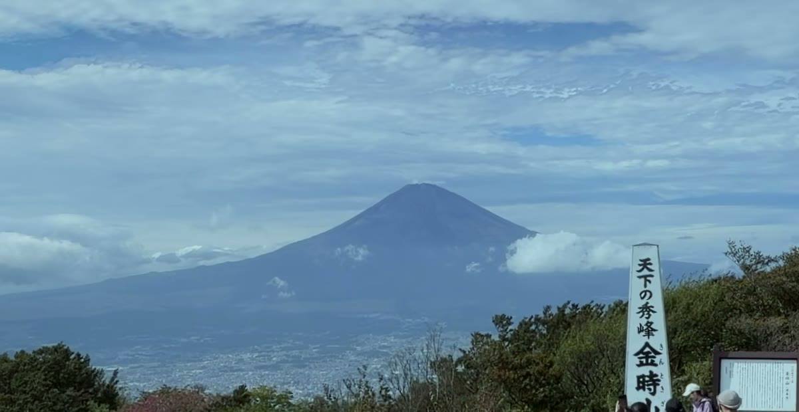

# panovi の使いかたブログ — 書き方と公開のしくみ

目的は **panovi を使ってみたいと思う人を増やすこと**。興味を持った人が迷わず最初の1本を撮れ、
撮った人がもっと使いこなせる記事を、2週間に1本のペースで出す。予定は [CALENDAR.md](CALENDAR.md)。

## しくみ（ふだん気にしなくていいこと）

```
content/blog/<slug>/meta.txt          公開日・分類・画像
content/blog/<slug>/ja.md en.md pt.md es.md   4言語の本文（日本語が正、ほかは訳）
        │
        ▼  tools/build_site.sh（= 多言語の生成 → tools/blog/build.py → 検査）
blog/<slug>/  en/blog/<slug>/  pt/blog/<slug>/  es/blog/<slug>/   記事ページ
blog/ ほか各言語の一覧・feed.xml、sitemap.xml、トップページの「使いかた・ヒント」
```

- **予約公開**: `meta.txt` の `date` が今日（日本時間）になると公開される。
  GitHub Actions（`.github/workflows/blog.yml`）が**毎朝6:05**に作り直して main へ push する。
  つまり、原稿を書いて先の日付で push しておけば、その日の朝に自動で出る。
- `content/blog/` に push したときも同じ処理が走る（今日以前の記事ならすぐ出る）。
- 生成物（`blog/` `en/blog/` …）は手で直さない。原稿を直して作り直す。
- 予約中の原稿も公開リポジトリには載る（`robots.txt` で検索からは外している）。
  発表前の新機能など、日付まで伏せたいものは `draft: yes` にして手元に置いておく。

## 記事を1本足す

1. `content/blog/<slug>/` を作る。slug は英小文字・数字・ハイフン（URLになる。あとから変えない）
2. `meta.txt`

   ```
   date: 2027-01-08          公開日（日本時間のこの日の朝に出る）
   category: tips            start / tips / everyday / sports / news
   image: /img/hero.jpg      一覧とSNSで使う画像（サイトにあるファイル）
   order: 5                  入門の順番（start のときだけ意味がある。1 が「まずはここから」）
   draft: no                 yes なら日付が来ても出さない
   ```

3. `ja.md` を書く → `en.md` `pt.md` `es.md` に訳す（Claude Code なら `/panovi-blog` で下書きから訳まで頼める）
4. 確かめる

   ```sh
   python3 tools/blog/build.py --preview /tmp/panovi-preview   # 予約・下書きも入れて丸ごと作る
   python3 -m http.server -d /tmp/panovi-preview 8000          # http://localhost:8000/blog/
   sh tools/build_site.sh                                       # 本番と同じ作り直しと検査
   ```

5. commit して push。公開日が先なら、その日の朝に出る

## 本文の書き方

```markdown
---
title: 記事の題（— で副題を続けてよい）
description: 一覧・検索結果・SNSに出る1〜2文
image_alt: meta の image の説明
---

最初の段落がリード。

## 見出し

段落。**太字**、[リンク](post:tripod-setup)。

- 箇条書き
- 箇条書き

1. 手順
2. 手順

> **補足**：枠で囲んだ注意書きになる。



{{appstore}}
```

- 見出し・箇条書き・画像の前後には**空行**を入れる
- リンク先の書き方（言語ごとの正しいURLに直して出す）

  | 書き方 | 行き先 |
  |---|---|
  | `post:<slug>` | その言語のその記事。**まだ公開されていなければリンクにしない**（「次に読む」の箇条書きなら項目ごと隠す） |
  | `post:<slug>\|home:#tripod` | 公開されるまでは `|` のうしろへ飛ばす |
  | `home:#price` | その言語のトップページの節（#why #try #how #tripod #lend #borrow #price #faq） |
  | `viewer:` / `viewer:guide` | その言語の panovi viewer / その使い方 |
  | `https://…` | そのまま（Amazon は自動で `sponsored`） |

- `{{appstore}}` は App Store へのボタン。押された数は記事ごとに Google Analytics の `appstore_click` で見られる
- 4言語で **見出し・画像・`{{appstore}}` の数がそろっていない**と作るときに止まる（訳し漏れの検出）
- en/pt/es に日本語の文字が残っていても止まる。「」は “ ” にする

## 書くときの決まり（アプリの説明と同じ線）

- **存在しない機能を書かない。** 迷ったらアプリのコード（`../Panovi`）とストアの説明文
  （`MultiCamVideoRecPJ/tools/store_metadata/ja.json`）で確かめる。言える／言えないは
  `../Panovi/docs/訴求と見せ方.md` §5（例:「8Kで撮れる」は言えない。「8Kサイズに書き出せる」は言える）
- 画面のボタン名は**アプリの訳をそのまま**使う（`../Panovi/Panovi/Localizable.xcstrings`）。
  記事の言葉とアプリの画面が違うと、読んだ人が迷う
- 価格の額は書かない（国で違う）。「無料で3回」「イベント券（24時間）」「買い切り」の仕組みだけ
- 競合の製品名は出さない
- **検索で見つけてもらう**: `description` とリードの段落に、その言語の検索語を1回は自然に入れる
  （ja「パノラマ動画」「パノラマビデオ」、en “panoramic video”、pt “vídeo panorâmico”、es “video panorámico”。
  場面の言葉も: 運動会・発表会・旅行・サッカー／iPhone 2台）。`<title>` の後ろには生成器が
  「panovi パノラマ動画アプリ」などを自動で付けるので、題そのものは読みやすさを優先してよい
- 主役は運動会・発表会・旅行・普段の記録。サッカーの長回しは「深い層」向けに、順番をあとにする
