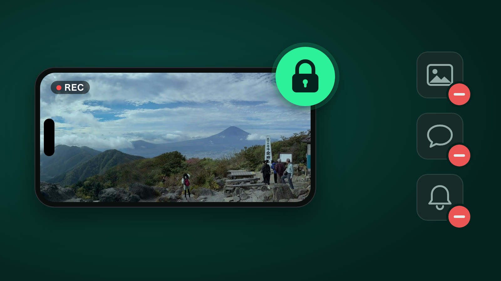

**結論**：iPhoneを人に貸すときは、iPhoneに最初から入っている**「アクセスガイド」**を使います。貸す人のiPhoneで一度オンにしておき、panovi を開いて**サイドボタンを3回押して「開始」**。これだけで、そのiPhoneは panovi の画面から動かなくなり、ホーム画面・写真・メッセージ・通知は見られません。終わったら**もう一度3回押してパスコード**で解除します。panovi の**パノラマ動画**は2台目が借りたiPhoneでも撮れるので、「貸してね」と頼みやすくするための大事な準備です。

## なぜ「貸す」が大事なのか

panovi は2台のiPhoneを三脚に並べて、左右の映像を1本のパノラマ動画にします。iPhoneを2台持っている人は多くありません。**2台目は家族や友達に借りる**のが、いちばん手軽な始め方です。

- 借りるiPhoneは**違う機種でも、違うApple IDでも**大丈夫です。QRコードを読み合うだけでつながります（iOS 18以降）
- 貸す側は、無料で panovi を入れるだけ。撮影も転送も無料で、**貸した人にお金がかかることはありません**
- インターネットも使いません。2台は直接つながります

ただ、貸す側からすると「写真やLINEを見られないかな」「通知が出たら恥ずかしい」と気になるものです。そこで使うのが「アクセスガイド」です。

## 「アクセスガイド」でできること

アクセスガイドは、iPhoneを**1つのアプリだけに固定する**、iPhoneに最初からある機能です。追加のアプリはいりません。

| 貸したiPhoneで | アクセスガイドなし | アクセスガイドあり |
|---|---|---|
| ホーム画面に戻る | できてしまう | できない |
| 写真・メッセージなどほかのアプリを開く | できてしまう | できない |
| 通知（メッセージ・LINEなど） | 画面に出る | 出ない |
| コントロールセンター・通知センター | 開ける | 開けない |
| 解除 | — | パスコード（または Face ID）が必要 |

panovi 自体も、借りたiPhoneの写真を見ることはありません。panovi が写真アプリに求めるのは**「追加だけ」の許可**で、撮った動画を保存するためのものです。もとからある写真やビデオは読み込めません。

## 最初に1回だけ：アクセスガイドをオンにする

貸す人のiPhoneで、撮影の前に（できれば前の日に）済ませておきます。

1. 「設定」→「アクセシビリティ」→「アクセスガイド」を開いて、**オン**にする
2. 「パスコード設定」→「アクセスガイドのパスコードを設定」で、**解除用のパスコード**を決める。いつもの画面ロックと違う番号にしておくと、相手に教えずに済みます
3. 同じ画面の「Face ID」（ホームボタンのある機種は「Touch ID」）をオンにすると、持ち主の顔や指で解除できて楽です

> **補足**：アクセスガイドの設定にある「画面の自動ロック」は、そのままで大丈夫です。panovi は開いているあいだ画面が自動で消えないようにしているので、録画中に勝手にロックされることはありません。

## 撮影のとき：panovi を開いて「開始」

1. 貸す人のiPhoneで panovi を開き、QRコードを読み取って**「カメラにする」**まで進める
2. **サイドボタンをすばやく3回**押す（ホームボタンのある機種はホームボタンを3回）
3. 左下の「オプション」で、**「サイドボタン」はオフのまま**にしておく。うっかり押して画面が消え、録画が止まるのを防げます
4. 右上の**「開始」**を押す

あとはふつうに三脚へ載せて撮るだけです。画面の操作はそのままできるので、置き方の確認も録画も、いつもどおり進められます。

> **補足**：「タッチ」をオフにすると画面がまったく反応しなくなり、panovi の操作もできなくなります。ふつうはオンのままにしてください。

## 撮り終わったら：解除と片付け

1. **サイドボタンを3回**押して、パスコードを入れる（Face ID をオンにしていれば、サイドボタンを2回押して顔で解除）
2. 左上の**「終了」**を押す
3. 映像があなたのiPhoneへ転送されたのを確かめてから、**貸してくれた人に消してもらう**

借りたiPhoneにも、撮った映像が残ります（panovi の中の「この端末の動画」と、カメラロール）。結合するのはあなたのiPhoneなので、転送が済めば借りた側には必要ありません。お礼といっしょに「消しておいてね」と伝えて、写真アプリの「最近削除した項目」まで空にしてもらうと、容量もすっきりします。

## 貸す・借りるときのチェックリスト

- 借りるiPhoneが **iOS 18以降**で、panovi を入れてある（2台とも最新版に）
- 貸す人のiPhoneで**アクセスガイドをオン**にし、**解除用のパスコード**を決めた
- 電池が十分ある。長く撮るならモバイルバッテリーも
- **空き容量**に余裕がある。左右それぞれを4Kで撮るので、長く撮るほど使います
- 撮影のあと、転送が済んだら**借りたiPhoneの映像を消してもらう**

## よくある質問

### アクセスガイド中に通知が来たらどうなりますか？

画面に出ません。メッセージやアプリの通知は、アクセスガイドを終えるまで表示されないので、貸している間に相手のメッセージが人の目に触れる心配はありません。

### アクセスガイドのパスコードを忘れたら？

「Face ID」（または「Touch ID」）をオンにしておけば、持ち主の顔や指で解除できます。パスコードだけに頼らないよう、最初の設定で一緒にオンにしておくのがおすすめです。

### 借りたiPhoneの持ち主にお金はかかりますか？

かかりません。撮影も転送も無料です。お金がかかることがあるのは3分以上の結合だけで、それも結合するあなたのiPhoneだけです。panovi が勝手に課金することもありません。

### 借りたiPhoneの写真を panovi に見られることはありますか？

ありません。panovi が写真アプリに求めるのは、撮った動画を保存するための「追加だけ」の許可です。もとからある写真やビデオは読み込めません。映像をインターネットに上げることもありません。

### 違う機種・違うApple IDのiPhoneでも2台目になりますか？

なります。どの2台でも、QRコードを読み合うだけでつながります（iOS 18以降）。両方で使えるレンズは panovi が自動で選びます。

## 次に読む

- [はじめての panovi — 最初の1本を撮るまで](post:first-video)
- [きれいにつながる置き方 — 三脚と「ハの字」のコツ](post:tripod-setup)
- [よくある質問](home:#faq)

{{appstore}}
