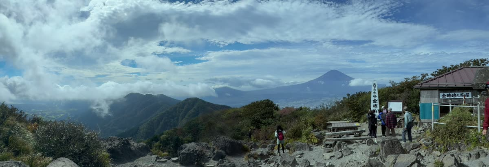

panovi is an app that turns the left and right footage from two iPhones, set side by side on a tripod, into one ultra-wide video. This post walks you through everything from installing the app to finishing your first video. Once you get used to it, setup takes just a few minutes.

## What you need

- **Two iPhones** (iOS 18 or later). They can be different models. The app picks a lens both can use
- **One tripod, plus a mount that holds the two side by side**. See "[Placing your iPhones for a clean stitch](post:tripod-setup|home:#tripod)" for details with photos
- The second iPhone can be one you borrow from family or a friend. Recording and transfer are free, so they only need to install the free app. You don't need to share an Apple ID

> **Want to try it with one iPhone first?** The app has sample videos built in. Before you find a second iPhone, you can see what a two-iPhone stitch looks like.

## 1. Pair the two iPhones

1. Open panovi on the first iPhone and tap **"Create group"**. A QR code appears on the screen
2. Open panovi on the second iPhone and use **"Scan QR code"** to scan the first iPhone's QR code
3. On the second iPhone, choose **"Use as camera"**

Now the two are paired. No internet is used, so they pair just the same on a field or a mountaintop with no signal.

## 2. Set them side by side on the tripod

Set the two iPhones side by side on the tripod, **turned so their lenses meet near the center**. Decide which side each one films with **"Tap to choose your side"** on the screen.

The trick is to angle both slightly inward, so the same scenery shows up at the inner edge of each. Tap **"Check the setup"** and the screen tells you how much they overlap, so you can adjust the angle while you watch.

Then tap **"Preview 3 seconds of motion"** and it stitches a short test clip on the spot and shows it to you. You can check that the seam looks clean before the real thing.

## 3. Shoot

Tap **"Start recording"** and both iPhones start recording at the same time. Once they are on the tripod, you don't touch them again. You never have to aim the camera, so you can focus on what is happening in front of you instead of on filming.

There is no limit on recording length. While recording, you can also use **power save**, which turns the screen off to save battery.

## 4. Stitch

When you stop recording, one iPhone receives the other's footage and stitches left and right into one video. It lines them up using the overlap so the seam doesn't stand out, and it also evens out differences in brightness and color between the two sides.

Use **"Save to Camera Roll"** to keep the finished video in the Photos app. **Stitches under 3 minutes are always free, with no limit on how many.**

## 5. Zoom in

This is where panovi gets fun. Each side records in 4K, so you keep far more detail than one iPhone filming the same width. You can watch the stitched video and **double-tap to zoom in, then drag to pan left and right**.

The whole scene and a close-up of whatever catches your eye, all from the same video. With panovi, you don't have to choose between zooming out and zooming in when you shoot.

You can also get a feel for the result in the [Try it section](home:#try) of this site.

## Read next

- [Placing your iPhones for a clean stitch — the tripod and the shallow V](post:tripod-setup)
- [FAQ](home:#faq)

{{appstore}}
