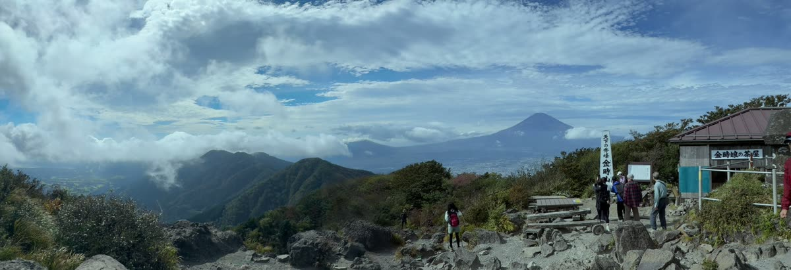
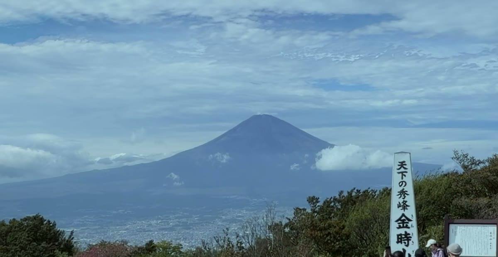

panovi は、2台のiPhoneを三脚に並べて置くだけで、左右の映像を1本の超ワイドなパノラマ動画にするアプリです。この記事では、アプリを入れてから最初の1本ができるまでを順番に説明します。慣れれば準備は数分です。

## 用意するもの

- **iPhone 2台**（iOS 18以降）。違う機種どうしでもかまいません。両方で使えるレンズをアプリが選びます
- **三脚1本と、2台を並べて固定できる金具**。くわしくは「[きれいにつながる置き方](post:tripod-setup|home:#tripod)」で写真つきで紹介します
- 2台目は、家族や友達に借りたiPhoneで大丈夫です。撮影も転送も無料なので、無料でアプリを入れてもらうだけ。同じApple IDである必要もありません

> **まずは1台で試したいとき**：アプリにはサンプル動画が入っています。2台目を用意する前に、「2台でつなぐとこうなる」というできあがりを先に見られます。

## 1. 2台をつなぐ

1. 1台目で panovi を開き、**「グループを作る」**を押します。画面にQRコードが出ます
2. 2台目で panovi を開き、**「QRを読み取る」**で1台目のQRコードを写します
3. 2台目で**「カメラにする」**を選びます

これで2台がつながります。インターネットは使わないので、電波の届かないグラウンドや山の上でもそのままつながります。

## 2. 三脚に並べて置く

2台を三脚に並べ、**レンズどうしが中央で近づく向き**に置きます。それぞれが左右どちらを撮るかは、画面の**「自分の担当をタップで選択」**で決めます。

2台を少し内側へ向けて、同じ景色が両方の内側の端に写るようにするのがコツです。**「配置を確認」**を押すと、画面が重なり具合を教えてくれるので、見ながら角度を合わせます。

さらに**「3秒で動きを確認」**を押すと、短い確認用の動画をその場でつないで見せてくれます。本番の前に、つなぎ目がきれいかを確かめておけます。

## 3. 撮る

**「撮影をはじめる」**で、2台が同時に録画を始めます。三脚に据えたら、あとはもう触りません。カメラを振らなくていいので、撮ることより目の前の出来事に集中できます。

撮影の長さに制限はありません。録画中は画面を消して電池の減りを抑える**省エネ**も使えます。

## 4. つなぐ

録画を止めたら、片方の端末が相手の映像を受け取り、左右を1本につなぎます。継ぎ目が目立たないよう重なりを見ながら位置を合わせ、左右の明るさや色の差もそろえます。

できた動画は**「カメラロールに保存」**で写真アプリに残せます。**3分未満の結合は、ずっと無料・回数無制限**です。

## 5. 寄って見る

panovi のいちばんの楽しみはここからです。左右それぞれを4Kで撮っているので、1台で同じ広さを撮るより細かく残っています。結合した動画は**ダブルタップで拡大、ドラッグで左右へ**動かしながら見られます。

全体の流れも、気になるところのアップも、同じ1本から。撮るときに「引くか寄るか」を選ばなくていいのが panovi です。

できあがりの手ざわりは、このサイトの[体験コーナー](home:#try)でも試せます。

## 次に読む

- [きれいにつながる置き方 — 三脚と「ハの字」のコツ](post:tripod-setup)
- [よくある質問](home:#faq)

{{appstore}}
