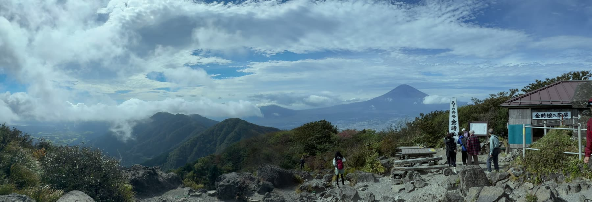

**Resposta curta**: o modo “Pano” da câmera do iPhone grava **fotos (imagens paradas)**. Para guardar uma paisagem ampla em movimento como **vídeo panorâmico**, há 3 jeitos: ① gravar com a ultra-angular (0,5x) da câmera padrão, ② gravar com a grande-angular e a ultra-angular ao mesmo tempo no “Gravar com um iPhone” do panovi, ③ colocar **dois iPhones lado a lado em um tripé** e unir tudo em um só vídeo com o panovi. O jeito que guarda a área mais ampla, com mais detalhes, é o ③.

## A diferença entre a foto panorâmica e o vídeo panorâmico

No modo “Pano” da câmera, você move o iPhone para o lado enquanto fotografa e ele cria uma única foto horizontal. É perfeito para paisagens paradas, mas registra só um instante. Pessoas e carros em movimento podem sair cortados ou distorcidos no meio.

O vídeo panorâmico mantém a largura horizontal e **também guarda o tempo**. As nuvens passando, as ondas chegando, as crianças correndo, o andamento do jogo. Você pode rever a paisagem ampla em movimento, do jeito que estava.

## Comparando os 3 jeitos

| Jeito | Do que você precisa | Amplitude | Detalhe | Melhor para |
|---|---|---|---|---|
| ① Ultra-angular da câmera padrão (0,5x) | 1 iPhone | Ampla | O de 1 iPhone | Quando você só quer gravar algo amplo |
| ② “Gravar com um iPhone” do panovi | 1 iPhone | Ampla | Centro nítido, com a grande-angular | Pequenos registros de passeios e viagens |
| ③ panovi com 2 iPhones | 2 iPhones + tripé | A mais ampla | Cada lado em 4K | Dia de esportes da escola, apresentações, paisagens incríveis, jogos de futebol |

## ① Gravar com a ultra-angular (0,5x) da câmera padrão

É o jeito mais fácil. Basta escolher “0,5” no modo de vídeo do app Câmera. Não é preciso instalar nenhum app.

Mas, como a cena ampla é gravada com um só iPhone e uma só lente, pessoas e objetos distantes ficam pequenos. Se você der zoom depois, a falta de nitidez aparece com facilidade.

## ② “Gravar com um iPhone” do panovi

O **“Gravar com um iPhone”** do panovi **grava com a lente grande-angular e a ultra-angular do iPhone ao mesmo tempo** e transforma tudo em um só vídeo. No centro fica a imagem da lente grande-angular, de resolução mais alta, e em volta, a imagem da lente ultra-angular.

Durante a gravação, você pode dar zoom como na câmera de sempre, e a gravação guarda tudo em volta. O movimento do zoom também fica registrado, então dá para ajustar o enquadramento depois. Explicamos tudo em “[Agora dá para gravar com um iPhone só — grande-angular e ultra-angular ao mesmo tempo](post:one-iphone)”.

## ③ Gravar com dois iPhones lado a lado em um tripé

É o jeito básico de usar o panovi. Você coloca dois iPhones lado a lado em um só tripé e une as imagens da esquerda e da direita em **um só vídeo panorâmico ultra-amplo**.

- **Cada lado é gravado em 4K**, então você guarda mais detalhes do que gravando a mesma largura com um iPhone só. Ao assistir, mesmo dando zoom com dois toques, o que você quer ver aparece nítido
- Depois de colocar no tripé, você não mexe mais. **Não é preciso apontar a câmera**, então você não perde nenhum momento
- O segundo pode ser o iPhone de alguém da família ou de um amigo. Mesmo com modelos diferentes ou Contas Apple diferentes, os dois se conectam pelo código QR

É ideal para cenas em que você quer “pegar tudo, de ponta a ponta”: o dia de esportes da escola ou uma apresentação inteira, a paisagem do alto da montanha, um jogo de futebol do começo ao fim. O passo a passo está em “[Primeiros passos com o panovi — até o seu primeiro vídeo](post:first-video)”.

## A diferença para uma câmera 360

Uma câmera 360 também grava uma área ampla, mas divide os pixels entre todas as direções. Por isso, cada direção fica com menos detalhe, e o que está longe aparece pequeno. O panovi usa os pixels só na direção que você quer gravar, então, mesmo gravando amplo, a cena fica grande e impactante. E você não precisa comprar nenhum equipamento extra.

## Perguntas frequentes

### Preciso de computador ou nuvem para gravar um vídeo panorâmico?

Não. No panovi, tudo acontece dentro do iPhone, da gravação à união. Também não é preciso criar conta. Exportar o vídeo em tamanho 8K ou em 8K + VR (360 graus) para publicar no YouTube também é possível só com o iPhone.

### Dá para usar de graça?

Gravar, transferir e verificar o alinhamento é grátis, por quantos minutos você quiser. Uniões de menos de 3 minutos também são sempre grátis, sem limite. Só as uniões longas, de 3 minutos ou mais, podem ser testadas grátis 3 vezes. Depois, você escolhe entre o passe de evento (24 horas) e a compra única. Não é assinatura mensal.

### Em quais iPhones funciona?

Funciona em iPhones com iOS 18 ou posterior. Para gravar com dois, eles podem ser de modelos diferentes. O “Gravar com um iPhone” funciona nos iPhones que têm lente ultra-angular e conseguem gravar com as duas lentes ao mesmo tempo.

### Dá para gravar um jogo de futebol inteiro?

Dá. Com o tripé parado e as duas traves na imagem, você grava o jogo até o fim. Onde colocar e como usar o controle remoto, mostramos em “[Filme o jogo de futebol inteiro — onde colocar, controle remoto e bateria](post:whole-match)”.

## Leia também

- [Primeiros passos com o panovi — até o seu primeiro vídeo](post:first-video)
- [Como posicionar para uma emenda perfeita — o tripé e o segredo do “V”](post:tripod-setup)

{{appstore}}
