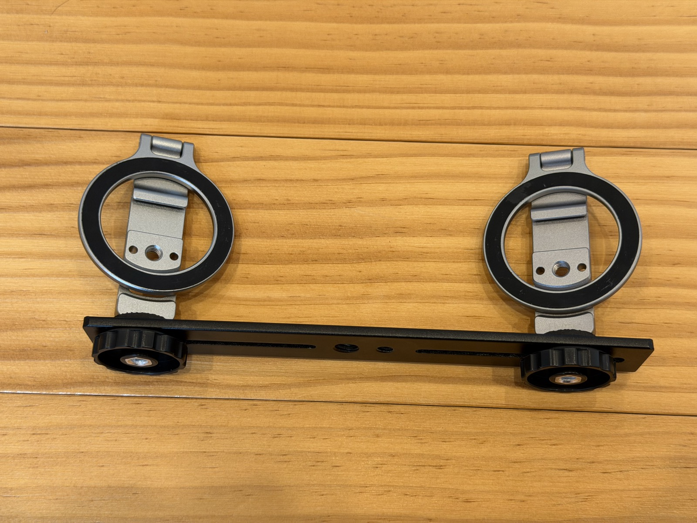

**In short**: to film a recital or school play from the audience, set up a single tripod **at the very back of the audience, straight in front of the center of the stage**, put two iPhones on it in a **shallow V**, and capture **the whole stage, end to end, in one panoramic video**. You never have to pan, so your child is in the video wherever they stand on stage, and you get to watch the show with your own eyes. This post covers where to set up, how high, which lens, lighting, battery and the pre-show check.

## First, check the filming rules

Every venue and every school has its own rules for filming recitals and school plays. **Many venues don't allow tripods, or only allow filming from a set area.**

- Ask the organizer (the school, preschool or studio) beforehand whether filming and tripods are allowed
- If there is a filming section or area, use it
- Never set up in an aisle or in front of an emergency exit
- Once the tripod is up, turn around and check that you aren't blocking anyone's view

Other children will be on stage too. Keep the video for your family, and follow the school's rules if you ever want to post it online.

## Where to set up: the very back, straight in front of center stage

Set up **straight in front of the center of the stage**, and both wings fit in evenly, with the center of the stage in the center of the frame. How far back you are changes things like this:

| Spot | Good points | Watch out for |
|---|---|---|
| The very back of the audience (by the back wall or in the standing area) | Nobody behind you, so you can raise the tripod | Don't block the aisle. Some venues don't allow it |
| The front row of a balcony or upper level | You look down over the whole stage, with no heads in the way | Keep the railing from sitting right in front of the lenses |
| A filming section set by the school or studio | You can use a tripod within the rules, without worrying | Often off to one side. Pick a spot as close to center as you can |
| Near the front of the audience | The stage looks big | A tripod here blocks the view of people behind you. Best avoided |

## Spacing and angle: no gap, in a shallow V

Don't put the two iPhones apart. Put a dual mount on one tripod and set them **with the lenses close together in the center**. Seen from above, the two iPhones form a shallow V. The farther apart the lenses are, the more the left and right views differ, and the more likely the seam is to look misaligned. And with just one tripod, you take up less room in the audience.

For the angle, turn both iPhones slightly inward so the middle of the stage shows up at the inner edge of both views. Tap **"Check the setup"** and the screen tells you whether there is enough overlap, so you can adjust while you watch. Finally, check that **the left and right wings of the stage each sit inside the outer edges of the frame**. How to build the mount is shown with photos in "[Placing your iPhones for a clean stitch](post:tripod-setup)".

## Height: above the heads in front of you

The seam sits in the middle of the frame. If **the head of someone sitting right in front of the camera** ends up there, the left and right views differ a lot and the seam is more likely to look off.

- Raise the lenses above the heads of the people seated in front of you
- Keep them high enough that hands raised for clapping stay clear of the seam
- A taller tripod blocks more of the view behind you, so **only go high where nobody is behind you**

If you can only film from a seat, good manners mean keeping the tripod no higher than your own head. Even if a few heads show at the bottom, the video is easy to enjoy as long as the stage is joined up.

## Lens: Wide from the back, Ultra Wide near the front

You can pick the lens under **"Lens"** on the screen you see once both iPhones are on the tripod. Only lenses both iPhones have are shown, so it works even with two different models.

| Lens | Best for | Notes |
|---|---|---|
| **Wide** | A stage a little far away, from the back or a balcony | People on stage look bigger. Overlap tends to be smaller |
| **Ultra Wide** | Seats close to the stage, or a very wide stage | Fits more in, with roughly twice the overlap of Wide |

Start with Wide and tap "Check the setup". If both ends of the stage don't fit, or the screen says there isn't enough overlap, switch to Ultra Wide. On some models, Wide is the only lens both iPhones share. You **can't change the lens while recording**, so decide before the show starts.

Focus is set to **"Lock to far"** from the start. It won't jump to the heads or hands in front of you, so it stays on the stage the whole time (you can switch it to "Automatic" from a third iPhone used as a remote).

## Stage lighting and brightness

The stage is bright and the audience is dark. This is where recital videos differ the most.

- **Fill most of the frame with the stage**: the camera sets brightness automatically. If a lot of dark audience or ceiling is in the frame, it gets pulled toward that, and faces and costumes on stage are more likely to blow out to white
- **A small difference between left and right is fine**: even if the lighting makes the two cameras come out a little different, stitching matches the color and brightness of the left and right sides naturally
- **Some scenes are dark**: blackouts and shadow-play scenes come out dark. It helps to expect that the video won't always look as bright as it did to your eyes

If you see a band of brightness in smooth areas like a wall or the curtain after stitching, try switching **"Matching colour at the seam"** on the stitching screen.

## Battery and free space for long shows

There is no limit on recording length. Even for a recital that runs over an hour, what decides whether you make it to the end is battery and free space.

- Turn on **"Power saving while recording"** and the camera view goes away: the screen turns black, with just the recording indicator and elapsed time shown large. It saves battery, and in a dark hall the screen's light is less likely to bother the people behind you
- For a long show, connecting a portable battery to each iPhone gives you peace of mind
- Both sides are recorded in 4K, so you need a good amount of free space. The day before, check your free space in **"Videos on This Device"** and clear out videos you don't need. If there isn't enough, the app tells you roughly how much you need
- Silence both iPhones so no ringtones or notification sounds go off

If you have a third iPhone, **"Use as remote"** turns it into a remote in your hand. Without touching the tripod, you can start and stop recording and check each camera's battery and free space.

## Before the show: "Preview 3 seconds of motion"

Once you're set up, tap **"Preview 3 seconds of motion"** before the show. It stitches a 3-second test clip on the spot, so you can check these three things before you record. This check is free, as many times as you like.

1. Do both wings of the stage fit?
2. Is the edge of the stage floor or the curtain level?
3. Is anyone's head or a railing sitting on the seam?

Before the show the curtain is closed and the house lights are on, so checking again once the stage lights come up (during the opening speech, for example) gives you extra peace of mind. Then tap **"Start recording"** and both iPhones start recording at the same time. After that, leave the tripod alone and enjoy the show.

## Stitch on the way home, zoom in at home

When you stop recording, tap **"Stitch recordings"** to join the two into one video. One iPhone receives the other's video and joins the left and right into one. No computer or cloud needed. It all **happens on the iPhone**, so if you stitch on the drive or train ride home, it's ready to watch when you get there.

- Keep the two iPhones near each other while the other video is being received. If you borrowed the second iPhone, finish receiving before you part ways
- Keep the app open until stitching finishes. Switching to another app pauses it
- Save the finished video to the Photos app with **"Save to Camera Roll"**
- If you recorded each act separately, **"Stitch and save all"** joins them one after another

When watching, **double-tap to zoom in and drag to pan left and right**. The whole stage and your child's face, all from the same video.

Stitches under 3 minutes are always free. **Stitches of 3 minutes or more**, like a recital, can be tried 3 times for free, and after that you choose between an **event pass (24 hours)** and a **one-time unlock**. You are never charged without your say: before a free use is spent, the screen asks you first, and it only counts when the save succeeds. It is not a subscription. See [pricing](home:#price) for details.

## Frequently asked questions

### Where in the audience should I film a recital from?

The very back of the audience, straight in front of the center of the stage. Nobody is behind you, so you can raise the tripod above the heads in front and fit both ends of the stage. The front row of a balcony or a filming section set by the school also works well.

### What if the venue doesn't allow tripods?

Follow the venue's rules. Filming with two iPhones needs both held still side by side on a tripod. If tripods aren't allowed, [Record with one phone](post:one-iphone) lets you hold a single iPhone in your hand and record with the wide and ultra wide lenses at the same time to capture a wide view.

### Will my child be in the video even at the edge of the stage?

Yes. As long as both wings of the stage are in the frame, your child is in the video wherever they stand, without any panning. When watching, double-tap to zoom in and find them.

### Can I record a recital that runs over an hour all the way to the end?

Yes. There is no limit on recording length. Turn the screen off with "Power saving while recording", connect a portable battery to each iPhone, and check your free space in "Videos on This Device" the day before.

## Read next

- [Getting started with panovi — shooting your first video](post:first-video)
- [Placing your iPhones for a clean stitch — the tripod and the shallow V](post:tripod-setup)
- [How to lend your iPhone safely — keep it on panovi with Guided Access](post:borrow-iphone)

{{appstore}}
