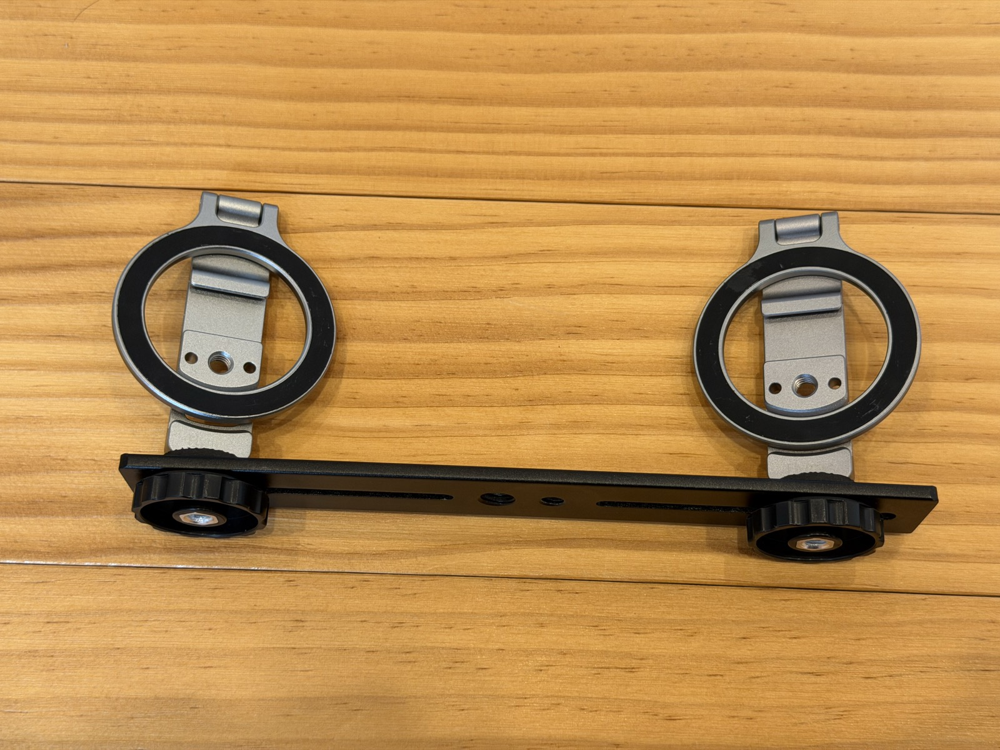

**En resumen**: para grabar el festival o la obra del colegio desde el público, pon un solo trípode **al fondo del público, justo enfrente del centro del escenario**, coloca los dos iPhone **en forma de V** y graba **todo el escenario, de punta a punta, en un solo video panorámico**. Como no hace falta mover la cámara, tu hijo sale en el video esté donde esté en el escenario, y tú puedes ver la función con tus propios ojos. En este artículo reunimos los trucos sobre el lugar, la altura, el lente, la luz, la batería y la prueba antes de empezar.

## Primero, revisa las normas para grabar

Cada colegio y cada sala tiene sus propias normas para grabar funciones y festivales. **En muchos lugares no se permite el trípode, o solo se puede grabar desde una zona concreta.**

- Pregunta antes a los organizadores (el colegio, el jardín o la academia) si se puede grabar y usar trípode
- Si hay una zona reservada para grabar, úsala
- No pongas el trípode en el pasillo ni delante de una salida de emergencia
- Cuando lo montes, mira hacia atrás y comprueba que no le tapas la vista a nadie

En el escenario también salen otros niños. Guarda el video para tu familia y, si quieres publicarlo en internet, sigue las normas del colegio.

## Dónde ponerlo: al fondo del público, frente al centro del escenario

Si lo pones **justo enfrente del centro del escenario**, los dos laterales entran por igual y el centro del escenario queda en el centro de la imagen. Según lo lejos que estés, cambia lo siguiente:

| Lugar | Ventajas | Cuidado con |
|---|---|---|
| Al fondo del público (junto a la pared del fondo o en la zona de pie) | No hay nadie detrás, así que puedes subir el trípode | No bloquees el pasillo. En algunas salas no se permite |
| Primera fila del palco o de la planta alta | Ves todo el escenario desde arriba, sin cabezas delante | Que la barandilla no quede justo delante de las cámaras |
| Zona para grabar que fija el colegio o la academia | Puedes usar el trípode dentro de las normas, sin preocuparte | Suele quedar a un lado. Elige el sitio más centrado posible |
| Cerca de las primeras filas | El escenario se ve grande | El trípode tapa la vista a los de atrás. Mejor evitarlo |

## Separación y ángulo: juntos, en forma de V

No separes los dos iPhone. Pon un soporte doble en un solo trípode y colócalos **con las cámaras juntas, en el centro**. Vistos desde arriba, los dos forman una V muy abierta. Cuanto más lejos esté una cámara de la otra, más distinta se ve la imagen de cada lado y más fácil es que la unión se vea desalineada. Además, con un solo trípode ocupas menos espacio entre el público.

Para el ángulo, gira los dos iPhone un poco hacia dentro, de modo que el centro del escenario aparezca en el borde interior de las dos imágenes. Toca **“Verificar alineación”** y la pantalla te dice si hay suficiente superposición, para que ajustes mientras miras. Por último, comprueba que **los dos laterales del escenario quedan dentro de los bordes exteriores de la imagen**. Cómo armar el soporte lo explicamos con fotos en “[Cómo colocarlos para una unión limpia](post:tripod-setup)”.

## Altura: por encima de las cabezas de delante

La unión queda en el centro de la imagen. Si ahí aparece **la cabeza de alguien sentado justo delante de la cámara**, la imagen de cada lado cambia mucho y la unión se nota más.

- Deja las cámaras por encima de las cabezas de quienes están sentados delante
- Súbelas lo suficiente para que las manos levantadas al aplaudir no lleguen a la unión
- Cuanto más alto esté el trípode, más tapa la vista a los de atrás, así que **súbelo solo donde no haya nadie detrás**

Si solo puedes grabar desde tu asiento, lo educado es que el trípode no pase de la altura de tu cabeza. Aunque salgan algunas cabezas abajo, el video se disfruta igual si el escenario está bien unido.

## Lente: gran angular desde el fondo, ultra gran angular cerca

El lente se elige en **“Lente”**, en la pantalla que aparece con los dos iPhone ya en el trípode. Solo salen los lentes que tienen los dos iPhone, así que funciona aunque sean modelos distintos.

| Lente | Ideal para | Nota |
|---|---|---|
| **Gran angular** | Un escenario algo lejano, desde el fondo o el palco | Las personas del escenario salen más grandes. La superposición suele ser menor |
| **Ultra gran angular** | Asientos cerca del escenario, o un escenario muy ancho | Entra más, con cerca del doble de superposición que el gran angular |

Empieza con el gran angular y toca “Verificar alineación”. Si no entran las dos puntas del escenario, o la pantalla dice que falta superposición, cambia al ultra gran angular. En algunos modelos, el único lente que tienen los dos iPhone en común es el gran angular. **No se puede cambiar de lente mientras grabas**, así que decídelo antes de que empiece.

El enfoque viene en **“Fijo a lo lejos”** desde el principio. No salta a las cabezas ni a las manos de delante y se queda en el escenario todo el tiempo (puedes cambiarlo a “Automático” desde un tercer iPhone usado como control remoto).

## La luz del escenario y el brillo

El escenario está iluminado y el público, a oscuras. Aquí es donde más cambian los videos de un festival.

- **Que el escenario ocupe casi toda la imagen**: la cámara ajusta el brillo sola. Si entra mucho público a oscuras o mucho techo, se guía por eso, y las caras y los disfraces del escenario se queman en blanco con más facilidad
- **Una pequeña diferencia entre los lados no es problema**: aunque la luz deje las dos cámaras un poco distintas, al unir se igualan de forma natural el color y el brillo de los dos lados
- **Algunas escenas son oscuras**: los apagones y las escenas de sombras salen oscuros. Conviene saber que el video no siempre se verá tan claro como lo viste tú

Si después de unir ves una franja de brillo en zonas lisas, como una pared o el telón, prueba a cambiar el **“Ajuste de color en la unión”** en la pantalla de unión.

## Batería y espacio libre para funciones largas

No hay límite de duración de la grabación. Incluso en un festival de más de una hora, lo que decide si llegas al final es la batería y el espacio libre.

- Activa el **“Ahorro de energía al grabar”** y la imagen de la cámara desaparece: la pantalla se pone negra y solo se ven, en grande, el indicador de grabación y el tiempo transcurrido. Ahorra batería y, en la oscuridad de la sala, la luz de la pantalla molesta menos a los de atrás
- En una función larga, conectar una batería externa a cada iPhone te da tranquilidad
- Los dos lados se graban en 4K, así que hace falta bastante espacio libre. El día antes, mira el espacio libre en **“Videos en este iPhone”** y borra los videos que no necesites. Si falta espacio, la app te dice más o menos cuánto hace falta
- Pon los dos iPhone en silencio para que no suene ninguna llamada ni notificación

Si tienes un tercer iPhone, **“Usar como control remoto”** lo convierte en un control en tu mano. Sin tocar el trípode, puedes empezar y detener la grabación y ver la batería y el espacio libre de cada cámara.

## Antes de empezar: “Ver 3 segundos de movimiento”

Cuando lo tengas listo, toca **“Ver 3 segundos de movimiento”** antes de la función. Une en el momento un video de prueba de 3 segundos, para que compruebes estas tres cosas antes de grabar. Esta prueba es gratis y la puedes repetir las veces que quieras.

1. ¿Entran los dos laterales del escenario?
2. ¿El borde del suelo del escenario o del telón está recto?
3. ¿Hay alguna cabeza o barandilla encima de la unión?

Antes de empezar, el telón está cerrado y las luces de la sala encendidas, así que volver a comprobar cuando se encienden las luces del escenario (durante las palabras de bienvenida, por ejemplo) te da todavía más tranquilidad. Después, toca **“Empezar a grabar”** y los dos iPhone empiezan a grabar a la vez. A partir de ahí, no toques el trípode y disfruta de la función.

## Une de camino a casa y acerca la imagen en casa

Cuando detengas la grabación, toca **“Unir grabaciones”** para juntarlo todo en un solo video. Un iPhone recibe el video del otro y une los lados izquierdo y derecho. No hace falta computadora ni nube. Todo **ocurre dentro del iPhone**, así que, si lo unes en el auto o en el tren de vuelta, al llegar a casa ya lo puedes ver.

- Deja los dos iPhone cerca mientras se recibe el video del otro. Si te prestaron el segundo iPhone, termina de recibirlo antes de despedirte
- Mantén la app abierta hasta que termine la unión. Si cambias a otra app, se pausa
- Guarda el video terminado en la app Fotos con **“Guardar en Fotos”**
- Si grabaste cada número por separado, **“Unir y guardar todos”** los une uno tras otro

Al verlo, **toca dos veces para acercar y arrastra hacia los lados**. Todo el escenario y la cara de tu hijo, en el mismo video.

panovi es gratis, con compras dentro de la app. Mira los detalles en la [App Store](https://apps.apple.com/app/id6797261654).

## Preguntas frecuentes

### ¿Desde qué parte del público conviene grabar el festival?

Desde el fondo del público, justo enfrente del centro del escenario. Sin nadie detrás, puedes subir el trípode por encima de las cabezas de delante y que entren las dos puntas del escenario. La primera fila del palco o la zona para grabar que fija el colegio también funcionan bien.

### ¿Y si en la sala no se permite el trípode?

Sigue las normas de la sala. Para grabar con dos iPhone, los dos tienen que estar quietos uno al lado del otro en un trípode. Si no se permite el trípode, con [Grabar con un iPhone](post:one-iphone) puedes sostener un solo iPhone en la mano y grabar con el gran angular y el ultra gran angular a la vez para captar una vista amplia.

### ¿Sale mi hijo aunque esté en una esquina del escenario?

Sí. Si los dos laterales del escenario están en la imagen, tu hijo sale esté donde esté, sin mover la cámara. Al verlo, toca dos veces para acercar y encontrarlo.

### ¿Puedo grabar hasta el final un festival de más de una hora?

Sí. No hay límite de duración de la grabación. Apaga la pantalla con el “Ahorro de energía al grabar”, conecta una batería externa a cada iPhone y revisa el espacio libre en “Videos en este iPhone” el día antes.

## Sigue leyendo

- [Tu primer video con panovi — paso a paso](post:first-video)
- [Cómo colocarlos para una unión limpia — el trípode y la forma de V](post:tripod-setup)
- [¿Cómo prestar tu iPhone sin preocuparte? — Deja solo panovi en pantalla con Acceso guiado](post:borrow-iphone)

{{appstore}}
