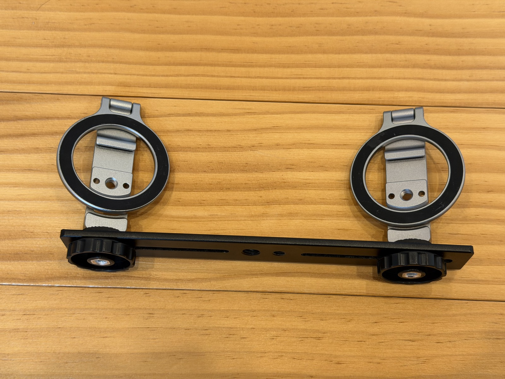

**結論**：発表会や学芸会を客席から撮るなら、三脚は**客席のいちばん後ろ、舞台の真ん中の正面**に1本だけ立て、2台のiPhoneを**ハの字**に並べて、**舞台の端から端までを1本のパノラマ動画**に収めるのがおすすめです。カメラを振らなくていいので、わが子が舞台のどこに立っても映っていて、撮る人も本番を自分の目で見られます。この記事では、置き場所・高さ・レンズ・照明・電池・本番前の確認のコツをまとめました。

## まず、撮影のきまりを確かめる

発表会や学芸会は、会場ごと・学校ごとに撮影のきまりが違います。**三脚を使えない会場や、撮影できる場所が決まっている会場も少なくありません。**

- 撮ってよいか、三脚を立ててよいかを、事前に主催者（学校・園・教室）に確かめる
- 撮影席や撮影エリアが決まっていれば、そこを使う
- 通路や非常口の前には置かない
- 三脚が後ろの人の視界をふさがないか、立てたら一度うしろを振り返って確かめる

舞台にはほかの子も映ります。撮った動画は家族で楽しむ範囲にとどめ、ネットに公開するときは園や学校のきまりに従ってください。

## 置き場所：客席のいちばん後ろ、舞台の真ん中の正面

舞台の**真ん中の正面**に置くと、左右の袖まで同じくらいの広さで入り、舞台の中央が画面の中央にきます。前後の位置は、場所ごとに次のような違いがあります。

| 場所 | よいところ | 気をつけること |
|---|---|---|
| 客席のいちばん後ろ（後ろの壁ぎわ・立ち見の場所） | 後ろに人がいないので、三脚を高くできる | 通路をふさがない。立ち入れない会場もある |
| 2階席・バルコニーの最前列 | 前の人の頭を気にせず、舞台全体を見下ろせる | 手すりがレンズのすぐ前に入らない位置にする |
| 学校や教室が決めた撮影席 | きまりの中で、気兼ねなく三脚を立てられる | 端に寄りがち。なるべく真ん中寄りを選ぶ |
| 客席の前のほう | 舞台が大きく写る | 三脚を立てると後ろの人の視界をふさぐ。避けるのが無難 |

## 2台の間隔と向き：離さずに「ハの字」

2台は**離して置きません**。1本の三脚に2台用の金具を載せ、**レンズどうしが中央で近づく向き**に並べます。上から見ると、2台がゆるい「ハの字」になる置き方です。レンズが離れているほど、左右の見え方の差が大きくなり、つなぎ目がずれやすくなります。三脚が1本で済むので、客席でも場所をとりません。

向きは、2台を少し内側へ向けて、舞台の真ん中あたりが両方の内側の端に写るようにします。**「配置を確認」**を押すと、重なりが足りているかを画面が教えてくれるので、見ながら角度を直します。最後に、**舞台の左右の袖が、それぞれ画面の外側の端に入っているか**を確かめてください。金具の組み方は「[きれいにつながる置き方](post:tripod-setup)」で写真つきで紹介しています。

## 高さ：前の人の頭より上に

つなぎ目は画面の真ん中にきます。そこに**カメラのすぐ近くにある前の人の頭**が入ると、左右の見え方の差が大きくなり、ずれて見えやすくなります。

- レンズを、前に座っている人の頭より上にする
- 拍手や手拍子で手が上がっても、つなぎ目にかかりにくい高さにする
- そのぶん後ろの人の視界をふさぎやすいので、**高くするのは後ろに人がいない場所だけ**にする

座席で使うしかないときは、三脚を自分の頭の高さより上げないのがマナーです。前の人の頭が下のほうに少し入っても、舞台がつながっていれば十分に見返せます。

## レンズ：後ろの席なら広角、前のほうなら超広角

レンズは、2台を三脚に据えた画面の**「レンズ」**で選べます。2台とも持っているレンズだけが出るので、違う機種どうしでもそろいます。

| レンズ | 向いている場面 | ひとこと |
|---|---|---|
| **広角** | 客席の後ろや2階席から、少し遠い舞台を撮る | 舞台の人が大きく写る。重なりが少なめになりやすい |
| **超広角** | 舞台に近い席や、横に長い舞台を撮る | 広く入り、重なりが広角の約2倍になる |

まず広角で「配置を確認」を押し、舞台の両端が入りきらないときや、重なりが足りないと出たときは超広角に切り替えます。機種によっては、2台で使えるのが広角だけのこともあります。レンズは**録画中は変えられない**ので、開演前に決めておきましょう。

ピントは、はじめから**「遠くに固定」**になっています。前の人の頭や手にピントが移らないので、遠くの舞台にずっと合ったままです（3台目のリモコンから「おまかせ」に切り替えることもできます）。

## 舞台の照明と明るさ

舞台は明るく、客席は暗い。発表会の撮影でいちばん差が出るのがここです。

- **画面のほとんどを舞台にする**：明るさはカメラが自動で合わせます。暗い客席や天井が大きく入ると、それに引っぱられて舞台の顔や衣装が白く飛びやすくなります
- **左右で明るさが少し違っても大丈夫**：照明の当たり方で左右のカメラの明るさがずれても、結合のときに左右の色と明るさを自然にそろえます
- **照明が落ちている場面もある**：暗転や影絵の演目は暗く写ります。目で見た明るさとは違うことがある、と思っておくと安心です

結合したあと、壁や幕のようななめらかな所に明るさの帯が見えたら、結合の画面の**「継ぎ目の色の合わせ方」**を切り替えて試してください。

## 長い発表会の電池と空き容量

録画の長さに制限はありません。1時間を超える発表会でも、続くかどうかを決めるのは電池と空き容量です。

- **「録画中の省エネ」**を入れると、カメラの映像が消えて画面が黒くなり、録画中の印と経過時間が大きく出ます。電池の減りを抑えられるうえ、暗い客席で画面の光が後ろの人の目に入りにくくなります
- 長い発表会なら、2台ともモバイルバッテリーをつないでおくと安心です
- 左右それぞれを4Kで記録するので、まとまった空き容量が要ります。前日に**「この端末の動画」**で空き容量を見て、いらない動画を片付けておきましょう。足りないときはアプリが必要な目安を教えてくれます
- 着信音や通知音が鳴らないよう、2台とも消音にしておきます

3台目のiPhoneがあれば、**「リモコンにする」**で手元のリモコンになります。三脚に触れずに、録画の開始・停止や、各カメラの電池と空き容量を確かめられます。

## 本番前に「3秒で動きを確認」

置けたら、開演前に**「3秒で動きを確認」**を押します。3秒だけの確認用の動画をその場でつないで見せてくれるので、録画の前に次の3つを確かめられます。この確認は無料で、何度でも使えます。

1. 舞台の左右の袖まで入っているか
2. 舞台の床や幕のふちが傾いていないか
3. つなぎ目に、前の人の頭や手すりがかかっていないか

開演前は幕が閉まっていて客席も明るいので、照明がついてから（開会のあいさつのときなど）もう一度確かめられると、なお安心です。確かめたら**「撮影をはじめる」**で、2台が同時に録画を始めます。あとは三脚に触らず、本番を見ていてください。

## 帰り道に結合して、家で寄って見る

録画を止めたら、**「撮影を結合する」**から1本につなぎます。片方の端末が相手の映像を受け取り、左右を1本にします。パソコンもクラウドもいらず、**iPhoneの中で済む**ので、帰りの車や電車の中で結合しておけば、家に着いたらすぐ見られます。

- 相手の映像を受け取るあいだは、2台をそばに置いておきます。2台目を借りた場合は、別れる前に受け取りまで済ませましょう
- 結合が終わるまでアプリを開いたままにします。ほかのアプリに切り替えると一時停止します
- できた動画は**「カメラロールに保存」**で写真アプリに残せます
- 演目ごとに録画を区切った日は、**「すべて結合して保存」**で順番にまとめてつなげます

見るときは、**ダブルタップで拡大、ドラッグで左右へ**。舞台の全体も、わが子の表情も、同じ1本から見られます。

3分未満の結合はずっと無料です。発表会のような**3分以上の結合**は、無料で3回まで試せて、そのあとは**イベント券（24時間）**か**買い切り**から選べます。勝手に課金されることはなく、無料の回数を使うときも画面で確かめてから進み、保存が成功したときだけ数えます。月額ではありません。くわしくは[料金の説明](home:#price)へ。

## よくある質問

### 発表会のビデオは、客席のどこから撮るのがいいですか？

客席のいちばん後ろ、舞台の真ん中の正面がおすすめです。後ろに人がいないので三脚を高くでき、前の人の頭を越えて舞台の両端まで入れられます。2階席の最前列や、学校が決めた撮影席も向いています。

### 三脚を使えない会場では、どうすればいいですか？

会場のきまりに従ってください。iPhone 2台で撮るには、2台を三脚で動かないように並べておく必要があります。三脚が使えないときは、[1台で撮る](post:one-iphone)を使えば、iPhone 1台を手に持ったまま、広角と超広角を同時に録って広く残せます。

### 子どもが舞台の端にいても映りますか？

映ります。舞台の左右の袖まで入るように置いておけば、カメラを振らなくても、舞台のどこに立っていても映っています。見るときに、ダブルタップで寄って探せます。

### 1時間を超える発表会でも、最後まで撮れますか？

撮れます。録画の長さに制限はありません。「録画中の省エネ」で画面を消し、2台ともモバイルバッテリーをつなぎ、前日に「この端末の動画」で空き容量を確かめておくと安心です。

## 次に読む

- [はじめての panovi — 最初の1本を撮るまで](post:first-video)
- [きれいにつながる置き方 — 三脚と「ハの字」のコツ](post:tripod-setup)
- [iPhoneを安心して貸すには？ — 「アクセスガイド」で panovi の画面だけにする](post:borrow-iphone)

{{appstore}}
