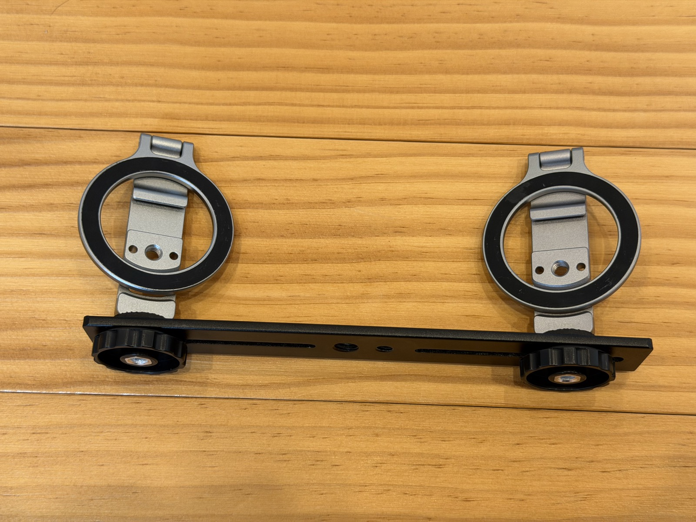

**Resumindo**: para filmar a apresentação ou o teatro da escola da plateia, monte um tripé só **no fundo da plateia, bem de frente para o centro do palco**, coloque os dois iPhones em **“V”** e grave **o palco inteiro, de ponta a ponta, em um só vídeo panorâmico**. Como não é preciso mexer a câmera, seu filho aparece no vídeo em qualquer lugar do palco, e você assiste à apresentação com os próprios olhos. Neste artigo reunimos as dicas de lugar, altura, lente, luz, bateria e a conferência antes de começar.

## Primeiro, confira as regras de filmagem

Cada escola e cada local tem suas próprias regras para filmar apresentações. **Muitos locais não permitem tripé, ou só deixam filmar de um lugar definido.**

- Pergunte antes à organização (escola, creche ou estúdio) se pode filmar e usar tripé
- Se houver um espaço reservado para filmagem, use esse espaço
- Não monte o tripé no corredor nem na frente da saída de emergência
- Depois de montar, olhe para trás e confira se não está tapando a visão de ninguém

Outras crianças também vão aparecer no palco. Guarde o vídeo para a família e, se quiser publicar na internet, siga as regras da escola.

## Onde colocar: no fundo da plateia, de frente para o centro do palco

Colocando o tripé **bem de frente para o centro do palco**, os dois lados entram por igual, e o centro do palco fica no centro da imagem. A distância até o palco muda as coisas assim:

| Lugar | Vantagens | Cuidados |
|---|---|---|
| No fundo da plateia (junto à parede do fundo ou na área de quem fica em pé) | Ninguém atrás, então dá para subir o tripé | Não bloqueie o corredor. Alguns locais não permitem |
| Primeira fila do mezanino ou do balcão | Você vê o palco inteiro de cima, sem cabeças na frente | Não deixe o guarda-corpo bem na frente das lentes |
| Espaço de filmagem definido pela escola | Dá para usar o tripé dentro das regras, sem preocupação | Costuma ficar de lado. Escolha o lugar mais central possível |
| Perto da frente da plateia | O palco aparece grande | O tripé tapa a visão de quem está atrás. Melhor evitar |

## Distância e ângulo: sem espaço entre eles, em “V”

Não separe os dois iPhones. Coloque um suporte duplo em um tripé só e posicione os dois **com as lentes bem próximas, no centro**. Vistos de cima, os dois formam um “V” bem aberto. Quanto mais longe uma lente estiver da outra, mais diferente fica a imagem de cada lado, e mais fácil a emenda sair desalinhada. E, com um tripé só, você ocupa menos espaço na plateia.

No ângulo, vire os dois iPhones um pouco para dentro, para que o meio do palco apareça na borda interna das duas imagens. Toque em **“Verificar alinhamento”** e a tela mostra se a sobreposição é suficiente, para você ajustar enquanto olha. Por fim, confira se **os dois lados do palco cabem dentro das bordas externas da imagem**. A montagem do suporte está com fotos em “[Como posicionar para uma emenda perfeita](post:tripod-setup)”.

## Altura: acima das cabeças da frente

A emenda fica no meio da imagem. Se **a cabeça de alguém sentado bem na frente da câmera** cair ali, a imagem de cada lado fica muito diferente e a emenda tende a aparecer.

- Deixe as lentes acima das cabeças das pessoas sentadas à sua frente
- Deixe alto o bastante para que as mãos levantadas nos aplausos não cheguem à emenda
- Quanto mais alto o tripé, mais ele tapa a visão de quem está atrás, então **só suba o tripé onde não há ninguém atrás**

Se você só puder filmar sentado na poltrona, a boa educação pede que o tripé não passe da altura da sua cabeça. Mesmo que algumas cabeças apareçam embaixo, o vídeo fica ótimo de rever se o palco estiver bem unido.

## Lente: grande-angular no fundo, ultra-angular perto do palco

A lente se escolhe em **“Lente”**, na tela que aparece com os dois iPhones já no tripé. Só aparecem as lentes que os dois iPhones têm, então funciona mesmo com modelos diferentes.

| Lente | Melhor para | Observação |
|---|---|---|
| **Grande-angular** | Um palco um pouco distante, filmado do fundo ou do mezanino | As pessoas no palco aparecem maiores. A sobreposição tende a ser menor |
| **Ultra-angular** | Lugares perto do palco, ou um palco muito largo | Cabe mais, com cerca de o dobro da sobreposição da grande-angular |

Comece pela grande-angular e toque em “Verificar alinhamento”. Se as duas pontas do palco não couberem, ou a tela disser que falta sobreposição, mude para a ultra-angular. Em alguns modelos, a única lente que os dois iPhones têm em comum é a grande-angular. **Não dá para trocar de lente durante a gravação**, então decida antes de começar.

O foco já vem em **“Fixar ao longe”**. Ele não pula para as cabeças ou mãos à sua frente e fica no palco o tempo todo (dá para mudar para “Automático” por um terceiro iPhone usado como controle).

## A luz do palco e o brilho

O palco é claro e a plateia é escura. É aqui que os vídeos de apresentação mais mudam.

- **Deixe o palco ocupar quase toda a imagem**: a câmera ajusta o brilho sozinha. Se entrar muita plateia escura ou teto, ela se guia por isso, e rostos e figurinos no palco ficam estourados de branco com mais facilidade
- **Uma pequena diferença entre os lados não é problema**: mesmo que a luz deixe as duas câmeras um pouco diferentes, a união iguala de forma natural a cor e o brilho dos dois lados
- **Algumas cenas são escuras**: blecautes e cenas de teatro de sombras ficam escuros. Vale saber que o vídeo nem sempre fica tão claro quanto você viu

Se depois da união aparecer uma faixa de brilho em áreas lisas, como uma parede ou a cortina, experimente trocar o **“Ajuste de cor na emenda”** na tela de união.

## Bateria e espaço livre para apresentações longas

Não há limite de duração da gravação. Mesmo numa apresentação de mais de uma hora, o que decide se você chega até o fim é a bateria e o espaço livre.

- Ligue a **“Economia de energia ao gravar”** e a imagem da câmera some: a tela fica preta, só com o indicador de gravação e o tempo decorrido em tamanho grande. Economiza bateria, e no escuro da plateia a luz da tela incomoda menos quem está atrás
- Numa apresentação longa, ligar uma bateria portátil em cada iPhone deixa tudo mais tranquilo
- Os dois lados são gravados em 4K, então é preciso bastante espaço livre. Na véspera, veja o espaço livre em **“Vídeos neste iPhone”** e apague os vídeos de que não precisa. Se faltar espaço, o app mostra mais ou menos quanto é necessário
- Deixe os dois iPhones no silencioso, para nenhum toque ou notificação soar

Se você tiver um terceiro iPhone, **“Usar como controle”** transforma ele em um controle remoto na sua mão. Sem tocar no tripé, dá para começar e parar a gravação e ver a bateria e o espaço livre de cada câmera.

## Antes de começar: “Ver 3 segundos de movimento”

Com tudo montado, toque em **“Ver 3 segundos de movimento”** antes da apresentação. Ele une ali mesmo um vídeo de teste de 3 segundos, para você conferir estas três coisas antes de gravar. Essa conferência é grátis, quantas vezes quiser.

1. Os dois lados do palco cabem?
2. A borda do chão do palco ou da cortina está reta?
3. Tem alguma cabeça ou guarda-corpo em cima da emenda?

Antes de começar, a cortina está fechada e as luzes da plateia estão acesas. Conferir de novo quando a luz do palco acender (no discurso de abertura, por exemplo) deixa tudo ainda mais seguro. Depois, toque em **“Começar a gravar”** e os dois iPhones começam a gravar ao mesmo tempo. A partir daí, não mexa no tripé e aproveite a apresentação.

## Una na volta para casa e amplie em casa

Quando parar a gravação, toque em **“Unir gravações”** para juntar tudo em um só vídeo. Um iPhone recebe o vídeo do outro e une os lados esquerdo e direito. Não precisa de computador nem de nuvem. Tudo **acontece dentro do iPhone**, então, se você unir no carro ou no ônibus na volta, o vídeo já está pronto quando chegar em casa.

- Deixe os dois iPhones perto um do outro enquanto o vídeo do outro é recebido. Se você pegou o segundo iPhone emprestado, termine de receber antes de se despedir
- Deixe o app aberto até a união terminar. Mudar para outro app pausa o processo
- Guarde o vídeo pronto no app Fotos com **“Salvar em Fotos”**
- Se você gravou cada número separado, **“Unir e salvar todos”** une um depois do outro

Na hora de assistir, **toque duas vezes para ampliar e arraste para os lados**. O palco inteiro e o rosto do seu filho, tudo no mesmo vídeo.

O panovi é grátis para usar, com compras dentro do app. Veja os detalhes na [App Store](https://apps.apple.com/app/id6797261654).

## Perguntas frequentes

### De que lugar da plateia é melhor filmar a apresentação?

Do fundo da plateia, bem de frente para o centro do palco. Sem ninguém atrás, dá para subir o tripé acima das cabeças da frente e pegar as duas pontas do palco. A primeira fila do mezanino ou o espaço de filmagem definido pela escola também funcionam bem.

### E se o local não permitir tripé?

Siga as regras do local. Para filmar com dois iPhones, os dois precisam ficar parados lado a lado em um tripé. Se o tripé não for permitido, o [Gravar com um iPhone](post:one-iphone) deixa você segurar um iPhone só na mão e gravar com a grande-angular e a ultra-angular ao mesmo tempo, para pegar uma vista ampla.

### Meu filho aparece mesmo no canto do palco?

Aparece. Se os dois lados do palco estiverem na imagem, seu filho aparece em qualquer lugar onde estiver, sem mexer a câmera. Na hora de assistir, toque duas vezes para ampliar e encontrar ele.

### Dá para gravar até o fim uma apresentação de mais de uma hora?

Dá. Não há limite de duração da gravação. Apague a tela com a “Economia de energia ao gravar”, ligue uma bateria portátil em cada iPhone e confira o espaço livre em “Vídeos neste iPhone” na véspera.

## Leia também

- [Primeiros passos com o panovi — até o seu primeiro vídeo](post:first-video)
- [Como posicionar para uma emenda perfeita — o tripé e o segredo do “V”](post:tripod-setup)
- [Como emprestar o iPhone com segurança? — Use o “Acesso Guiado” para deixar só o panovi na tela](post:borrow-iphone)

{{appstore}}
