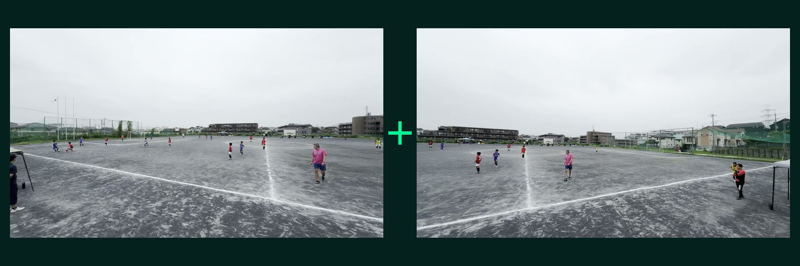

There are five main ways to film a youth soccer match: **one phone, an auto-tracking camera, a 360 camera, an action camera, or two iPhones making a panoramic video**. Two questions decide which one fits. **If you want the whole match, choose something that stays fixed and shoots wide.** **If you want to see your child up close, choose something you can zoom into afterward.** This post compares what each one is good at and what to watch out for — by setup, how much of the field it covers, whether you can zoom in later, and how the costs work.

## The short answer: fixed and wide for the whole match, zoom in later for your child

Two problems come up again and again with match videos.

- **The whole match isn't there**: while the camera is panning, whatever happens away from the ball ends up out of frame
- **Your child is tiny**: shoot wide, and each player is small

The surest way to keep the whole match is to fix the camera and get the field in from edge to edge. To see your child up close, you either zoom in while filming, or keep enough detail to zoom in afterward. Below, we compare each option on whether it can do both at once.

## One phone — the easiest, but you choose between the whole field and your child

You can start with just the phone in your pocket, so it's the easiest option.

- **Handheld**: you can follow your child or the ball and keep them large. In exchange, you spend the match staring at the screen, with little chance to watch the game with your own eyes
- **On a tripod, zoomed out**: it's easier to get the whole field in, but one camera covers all of that width, so each player looks small

It suits a first try, or filming just part of a match.

## An auto-tracking camera — it follows the ball, and the camera decides what you see

This is a camera that changes its direction or framing automatically to follow the ball and the players. Its biggest plus is that nobody has to pan the camera.

The thing to keep in mind is that **the camera decides what to show**. It follows the action around the ball, but your child away from the ball, or the defense, can end up out of frame. You need dedicated equipment, and how the costs work differs from product to product, so check what you'd pay beyond the camera itself before you buy.

## A 360 camera — everything around it, but the pixels are spread in every direction

This camera films everything around it at once — front, back and above. Its plus is that you choose which way to look afterward.

On the other hand, a 360 camera **spreads its pixels across every direction**, so each direction gets less detail and distant players look small. At a soccer match you almost always only want the field — not the stands behind you or the sky.

## One action camera (a wide-angle camera) — wide, but distant kids are small

A small, tough camera that covers a wide area on its own. Mount it on a tripod or a fence and it can film without anyone touching it.

But because one camera covers a wide area, distant kids look small, just like with one phone zoomed out. Wide-angle lenses also tend to bend things near the edges of the frame.

## Two iPhones side by side on a tripod (panovi) — set it and leave it, both goals in, zoom in later

panovi is an app that **puts two iPhones side by side on a tripod and turns the left and right views into one panoramic video**.

- **Set it and leave it**: nobody has to pan the camera. The person filming can watch the match and cheer with their own eyes
- **Both goals in**: set it in line with the halfway line, and both goals fit in one video
- **Zoom in later**: each side records in 4K and the two are joined, so it keeps more detail than one camera covering the same width. Double-tap the stitched video to zoom in and drag left and right to get close to your child
- **Play away from the ball is still there**: the camera never turns, so everything stays in the frame

You need two iPhones, one tripod and a mount to hold the two side by side. Borrowing an iPhone from family or a friend is fine. If both iPhones have an ultra wide lens, you can film as wide as about 190 degrees (the width depends on how you set them up).

panovi is free to use, with in-app purchases. There is no subscription.

## Side-by-side comparison

| Option | Can you leave it in place? | Are both goals in? | Can you zoom in later? | What you need | How the costs work |
|---|---|---|---|---|---|
| One phone (handheld) | No (someone has to pan) | Only if you pan | Only as large as you filmed it | A phone | Just what you already have |
| One phone (tripod) | Yes | In if you zoom out, but each player is small | Yes, with one camera's worth of detail | A phone and a tripod | What you have, plus a tripod |
| Auto-tracking camera | Yes | Only what it follows | Depends on the product | Dedicated equipment | Differs by product. Check costs beyond the camera itself |
| 360 camera | Yes | Yes | Yes, but the pixels are spread in every direction | A 360 camera | Dedicated equipment |
| One action camera | Yes | Usually, but distant players are small | Yes, with one camera's worth of detail | A camera and something to mount it | Dedicated equipment |
| Two iPhones (panovi) | Yes | Yes | Yes (4K on each side) | Two iPhones, a tripod and a mount | No dedicated camera and no subscription. Free to use, with in-app purchases |

## The tripod and where to set up

If you film from a fixed spot, where you set up matters most, whatever you use.

- Set up **in line with the halfway line**, and both goals fit in evenly
- Film from **as high up as you can**, and players in front and behind overlap less, so the whole play is easier to follow. Use a stand or a bank if there is one
- Pick a spot where people are unlikely to walk right in front of the camera

For how to film with panovi — checking your setup, using a third iPhone as a remote, getting the battery and free space ready, and stitching the first and second halves together — see “[Film a whole soccer match](post:whole-match)”. For lining the two iPhones up neatly, see “[Placing your iPhones for a clean stitch](post:tripod-setup)”, with photos.

For filming a stage from the audience, from one end to the other, such as a recital or a school play, see “[Where to put the tripod when filming a recital or school play](post:recital)”. Other common questions are answered in our “[FAQ](/en/faq/)”.

## Frequently asked questions

### Where should I put the camera to film a soccer match?

In line with the halfway line, as high up as you can. Both goals fit in evenly, and players in front and behind overlap less. Use a stand or a bank if there is one.

### Which is better: an auto-tracking camera, or a fixed camera that shoots wide?

It depends on what you want to keep. If you want the action around the ball large, a tracking camera suits you. If you want everything — play away from the ball and where your child is positioned — a fixed camera that films edge to edge, then zooming in later, suits you better.

### Will a phone's battery last through a whole match?

It depends on the model, the temperature and how long the match is. With panovi, use power save while recording to turn the screen off and save battery. For a long match, plugging in a power bank gives you peace of mind.

### What should I keep in mind when filming my child's match?

First, check the filming rules of the team, the tournament and the venue. Some places don't allow tripods, or only allow filming from a set area. Before you show the video to the team or post it online, get permission from the people in it.

## Read next

- [Film a whole soccer match — where to set up, the remote and the battery](post:whole-match)
- [Placing your iPhones for a clean stitch — the tripod and the shallow V](post:tripod-setup)
- [Getting started with panovi — shooting your first video](post:first-video)

{{appstore}}
