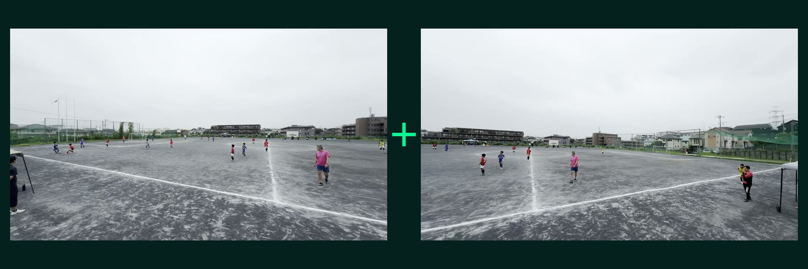

Para grabar un partido de fútbol infantil hay cinco opciones principales: **un celular, una cámara que sigue el balón sola, una cámara 360°, una cámara de acción o dos iPhone haciendo un video panorámico**. Para elegir, hay dos preguntas clave. **Si quieres el partido completo, elige algo que se quede fijo y grabe bien abierto.** **Si quieres ver a tu hijo de cerca, elige algo en lo que puedas acercarte después.** En este artículo comparamos en qué es buena cada opción y qué hay que tener en cuenta: cómo colocarla, cuánto de la cancha entra, si puedes acercarte después y cómo funcionan los costos.

## En resumen: para el partido completo, fijo y abierto; para tu hijo, acercarte después

En los videos de partidos hay dos problemas que se repiten.

- **No está el partido completo**: mientras la cámara se mueve, lo que pasa lejos del balón queda fuera de la imagen
- **Tu hijo sale pequeño**: si grabas abierto, cada jugador sale pequeño

La forma más segura de guardar el partido completo es dejar la cámara fija y que entre la cancha de punta a punta. Para ver a tu hijo de cerca, o te acercas al grabar, o guardas suficiente detalle para acercarte después. A continuación comparamos cada opción según si puede lograr las dos cosas a la vez.

## Un celular — lo más fácil, pero eliges entre la cancha completa y tu hijo

Puedes empezar solo con el celular que ya tienes, así que es la opción más fácil.

- **En la mano**: puedes seguir a tu hijo o al balón y que salgan grandes. A cambio, te pasas el partido mirando la pantalla y casi no lo ves con tus propios ojos
- **En un trípode, abierto**: es más fácil que entre toda la cancha, pero un solo celular cubre todo ese ancho, así que cada jugador sale pequeño

Sirve para una primera prueba o para grabar solo una parte del partido.

## Una cámara que sigue el balón — acompaña la jugada, y la cámara decide qué se ve

Es una cámara que cambia de dirección o de encuadre sola para seguir el balón y a los jugadores. Su mayor ventaja es que nadie tiene que mover la cámara.

Lo que hay que tener en cuenta es que **la cámara decide qué mostrar**. Sigue lo que pasa cerca del balón, pero tu hijo lejos del balón, o la defensa, pueden quedar fuera de la imagen. Necesitas un equipo propio, y la forma de cobro cambia según el producto, así que antes de comprar revisa qué pagarías además del aparato.

## Una cámara 360° — todo alrededor, pero los píxeles se reparten en todas las direcciones

Esta cámara graba todo a su alrededor a la vez: adelante, atrás y arriba. Su ventaja es que eliges hacia dónde mirar después.

En cambio, la cámara 360° **reparte sus píxeles en todas las direcciones**, así que cada dirección tiene menos detalle y los jugadores lejanos salen pequeños. En un partido de fútbol casi siempre solo quieres la cancha, no la tribuna detrás de ti ni el cielo.

## Una cámara de acción (cámara gran angular) — muy abierta, pero los niños lejanos salen pequeños

Una cámara pequeña y resistente que abarca un área amplia ella sola. Sujeta a un trípode o a una reja, graba sin que nadie la toque.

Pero, como una sola cámara cubre un área amplia, los niños lejanos salen pequeños, igual que con un celular abierto en el trípode. Los lentes gran angular también suelen curvar lo que está cerca de los bordes de la imagen.

## Dos iPhone uno al lado del otro en un trípode (panovi) — fijo, con las dos porterías y acercándote después

panovi es una app que **coloca dos iPhone uno al lado del otro en un trípode y convierte las imágenes izquierda y derecha en un solo video panorámico**.

- **Se queda fijo**: nadie tiene que mover la cámara. Quien graba puede ver el partido y alentar con sus propios ojos
- **Entran las dos porterías**: en la prolongación de la línea de medio campo, las dos porterías caben en un solo video
- **Acércate después**: cada lado se graba en 4K y se unen, así que guarda más detalle que una sola cámara cubriendo el mismo ancho. En el video unido, toca dos veces para acercarte y arrastra a los lados hasta llegar a tu hijo
- **Lo que pasa lejos del balón también queda**: la cámara no cambia de dirección, así que todo sigue en la imagen

Necesitas dos iPhone, un trípode y un soporte para ponerlos uno al lado del otro. Puedes usar un iPhone prestado de tu familia o de un amigo. Si los dos iPhone tienen lente ultra gran angular, puedes grabar hasta unos 190 grados (el ancho cambia según cómo los coloques).

Grabar es gratis, sin importar los minutos, y las uniones de menos de 3 minutos son siempre gratis. Lo único que puede costar dinero son las uniones largas, de 3 minutos o más, que puedes probar gratis 3 veces. Después, eliges entre el **pase de evento (24 horas)** e **Ilimitado (compra única)**. No hay suscripción.

## Tabla comparativa

| Opción | ¿Puede quedarse fija? | ¿Entran las dos porterías? | ¿Puedes acercarte después? | Qué necesitas | Cómo funcionan los costos |
|---|---|---|---|---|---|
| Un celular (en la mano) | No (alguien tiene que moverlo) | Solo si lo mueves | Solo al tamaño en que grabaste | Un celular | Solo lo que ya tienes |
| Un celular (trípode) | Sí | Si grabas abierto, pero cada jugador sale pequeño | Sí, con el detalle de una sola cámara | Celular y trípode | Lo que ya tienes, más un trípode |
| Cámara que sigue el balón | Sí | Solo lo que sigue | Depende del producto | Equipo propio | Cambia según el producto. Revisa los costos además del aparato |
| Cámara 360° | Sí | Sí | Sí, pero los píxeles se reparten en todas las direcciones | Una cámara 360° | Equipo propio |
| Una cámara de acción | Sí | Suelen entrar, pero los lejanos salen pequeños | Sí, con el detalle de una sola cámara | Cámara y algo para sujetarla | Equipo propio |
| Dos iPhone (panovi) | Sí | Sí | Sí (4K de cada lado) | Dos iPhone, trípode y soporte | Sin cámara propia y sin suscripción. Solo las uniones de 3 minutos o más pueden costar dinero |

## El trípode y dónde colocarlo

Si grabas desde un lugar fijo, el lugar es lo más importante, uses lo que uses.

- En la **prolongación de la línea de medio campo**, las dos porterías entran de forma equilibrada
- Grabando **desde lo más alto posible**, los jugadores de adelante y de atrás se tapan menos y se sigue mejor todo el juego. Si hay tribuna o un talud, úsalos
- Elige un lugar donde la gente no pase justo delante de la cámara

Para grabar con panovi — cómo revisar la ubicación, usar un tercer iPhone como control remoto, preparar la batería y el espacio libre, y unir el primer y el segundo tiempo — mira “[Graba el partido de fútbol completo](post:whole-match)”. Para alinear bien los dos iPhone, mira “[Cómo colocarlos para una unión limpia](post:tripod-setup)”, con fotos.

Para grabar un escenario desde el público, de punta a punta, como en el festival del colegio, mira “[¿Dónde poner el trípode para grabar el festival del colegio?](post:recital)”. Otras dudas comunes están en nuestras “[Preguntas frecuentes](/es/faq/)”.

## Preguntas frecuentes

### ¿Dónde pongo la cámara para grabar un partido de fútbol?

En la prolongación de la línea de medio campo, lo más alto que puedas. Las dos porterías entran de forma equilibrada, y los jugadores de adelante y de atrás se tapan menos. Si hay tribuna o un talud, úsalos.

### ¿Qué es mejor: una cámara que sigue el balón o una cámara fija que graba bien abierto?

Depende de lo que quieras guardar. Si quieres ver en grande lo que pasa cerca del balón, te conviene la cámara que lo sigue. Si quieres guardarlo todo — lo que pasa lejos del balón y la posición de tu hijo —, te conviene más una cámara fija que grabe de punta a punta, y acercarte después.

### ¿La batería del celular dura todo el partido?

Depende del modelo, de la temperatura y de la duración del partido. En panovi, usa el ahorro de energía mientras grabas para apagar la pantalla y que la batería rinda más. En un partido largo, conectar una batería externa te da tranquilidad.

### ¿Qué debo tener en cuenta al grabar el partido de mi hijo?

Primero, revisa las normas para grabar del equipo, del torneo y del lugar. En algunos lugares no se permite el trípode, o solo se puede grabar desde una zona concreta. Antes de mostrar el video al equipo o subirlo a internet, pide permiso a las personas que salen en él.

## Sigue leyendo

- [Graba el partido de fútbol completo — ubicación, control remoto y batería](post:whole-match)
- [Cómo colocarlos para una unión limpia — el trípode y la forma de V](post:tripod-setup)
- [Tu primer video con panovi — paso a paso](post:first-video)

{{appstore}}
