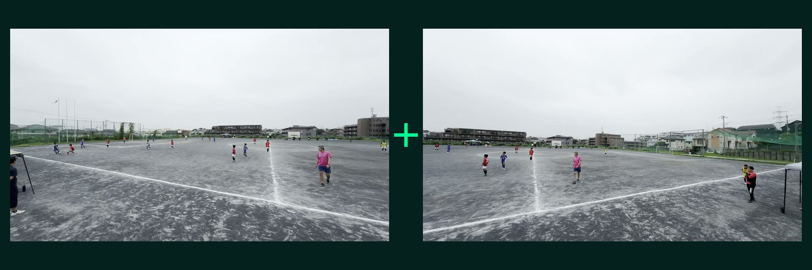

少年サッカーの試合を撮る道具は、大きく分けて**スマホ1台・自動で追いかけるカメラ・360度カメラ・アクションカメラ・iPhone 2台のパノラマ動画**の5つです。選ぶときの分かれ目は2つあります。**ピッチ全体を取りこぼさず残したいなら「固定して、広く撮る」もの**を、**わが子を大きく見たいなら「あとから寄れる」もの**を選びましょう。この記事では、それぞれの得意なことと気をつけることを、置き方・映る広さ・あとから寄れるか・費用の考え方で比べます。

## 結論：ピッチ全体なら「固定して広く」、わが子なら「あとから寄れる」

試合の動画でよくある困りごとは、次の2つです。

- **全体が映っていない**：カメラを振っているあいだに、ボールから離れたところで起きたことが画面の外になる
- **わが子が小さい**：広く撮ると、一人ひとりは小さく写る

全体を残すには、カメラを固定して、グラウンドの端から端までを入れるのがいちばん確実です。わが子を大きく見るには、撮るときに寄せるか、撮ったあとで寄れるだけの細かさを残しておくかのどちらかです。この2つを同時にかなえられるかどうかで、道具を比べていきます。

## スマホ1台で撮る — いちばん手軽。でも全体か、わが子かを選ぶ

手元のスマホだけで始められるので、いちばん手軽です。

- **手で持って撮る**：わが子やボールを追って大きく撮れます。そのかわり、撮る人は画面を見続けることになり、試合を自分の目で見る余裕は少なくなります
- **三脚で固定して引いて撮る**：全体は入りやすくなりますが、1台で広さを取るので、一人ひとりは小さく写ります

まず1本撮ってみたいときや、短い時間だけ撮るときに向いています。

## 自動で追いかけるカメラ — ボールを追う。何を映すかはカメラまかせ

ボールや選手の動きに合わせて、カメラが自動で向きや範囲を変えてくれる道具です。撮る人がカメラを振らなくてよいのが、いちばんの良さです。

気をつけたいのは、**何を映すかをカメラが決める**ことです。ボールのまわりは追ってくれますが、ボールから離れたところにいるわが子や、守備の動きは画面の外になることがあります。専用の機材を用意することになり、費用の形は製品ごとに違うので、買う前に本体以外にかかる料金も確かめておきましょう。

## 360度カメラ — ぐるりと全部。ただし画素が全部の向きに分かれる

前も後ろも上も、まわりの全部をいっぺんに撮れるカメラです。撮ったあとで見る向きを選べるのが良さです。

一方で、360度カメラは**画素を全方位に分けて使う**ので、一方向あたりは粗くなり、遠くの選手は小さく写ります。サッカーでは、映したいのはグラウンドの方向だけで、うしろの観客席や空は使わないことがほとんどです。

## アクションカメラ（広角のカメラ）1台 — 広いけれど、遠くの子は小さい

小さくて丈夫で、広い範囲を1台で撮れるカメラです。三脚やフェンスに付けておけば、置いたまま撮れます。

ただ、1台で広い範囲を入れるので、スマホ1台を引いて撮るときと同じく、遠くの子は小さく写ります。広角のレンズは、画面の端のほうが曲がって写りやすいのも特徴です。

## iPhone 2台を三脚に置きっぱなし（panovi）— ピッチ全体を両ゴールまで。あとから寄る

panovi（パノビ）は、**2台のiPhoneを三脚に並べて置き、左右の映像を1本のパノラマ動画にする**アプリです。

- **置いたまま撮れる**：カメラを振る人はいりません。撮る人も、試合を自分の目で見て応援できます
- **両ゴールまで入る**：ハーフウェーラインの延長に置くと、左右のゴールまでが1本の映像に入ります
- **あとから寄れる**：左右それぞれを4Kで撮ってつなぐので、1台で同じ広さを撮るより細かく残ります。結合した動画はダブルタップで拡大し、ドラッグで左右へ動かして、わが子のところへ寄って見られます
- **ボールから離れたところも取りこぼさない**：カメラが向きを変えないので、全部が画面の中に残っています

用意するのは、iPhone 2台と三脚1本、2台を並べる金具です。家族や友達のiPhoneを借りてもかまいません。2台とも超広角のレンズがあるiPhoneなら、約190度まで広く撮れます（広さは置き方で変わります）。

撮影は何分でも無料で、3分未満の結合もずっと無料です。お金がかかることがあるのは3分以上の長い結合だけで、無料で3回まで試せます。そのあとは**イベント券（24時間）**か**買い切り**から選べます。月額はありません。

## 比べる表

| 道具 | 置いたままでよいか | 両ゴールまで入るか | あとから寄れるか | 用意するもの | 費用の考え方 |
|---|---|---|---|---|---|
| スマホ1台（手持ち） | いいえ（撮る人が振る） | 振れば追える | 撮ったときの大きさのまま | スマホ | 手持ちの道具だけ |
| スマホ1台（三脚） | はい | 引けば入るが、一人ひとりは小さい | 寄れるが、細かさは1台分 | スマホ・三脚 | 手持ちの道具＋三脚 |
| 自動で追いかけるカメラ | はい | 追った範囲だけ | 製品による | 専用の機材 | 製品ごとに違う。本体以外の料金も確かめる |
| 360度カメラ | はい | 入る | 寄れるが、画素は全方位に分かれる | 360度カメラ | 専用の機材 |
| アクションカメラ1台 | はい | 入りやすいが、遠くは小さい | 寄れるが、細かさは1台分 | カメラ・固定する道具 | 専用の機材 |
| iPhone 2台（panovi） | はい | 入る | はい（左右それぞれ4K） | iPhone 2台・三脚・金具 | 専用のカメラも月額もいらない。3分以上の結合だけ有料のことがある |

## 三脚と置き場所

固定して撮るなら、どの道具でも置き場所がいちばん大事です。

- **ハーフウェーラインの延長上**に置くと、左右のゴールまでがバランスよく入ります
- **なるべく高い場所**から撮ると、手前と奥の選手の重なりが減って、全体の動きが見やすくなります。スタンドや土手があれば使いましょう
- 目の前を人が横切りにくい場所を選びます

panovi で撮るときの段取り（置き場所の確かめ方、3台目のiPhoneをリモコンにする方法、電池と空き容量の準備、前半と後半をまとめてつなぐ方法）は、「[少年サッカーの試合を三脚でまるごと撮る](post:whole-match)」にまとめました。2台の向きをきれいにそろえる置き方は「[きれいにつながる置き方](post:tripod-setup)」で写真つきで紹介しています。

発表会や学芸会のように、客席から舞台の端から端までを撮るときの考え方は「[発表会・学芸会のビデオ撮影、三脚はどこに置く？](post:recital)」で紹介しています。ほかによく聞かれることは「[よくある質問](/faq/)」にまとめています。

## よくある質問

### サッカーの試合を撮るなら、カメラはどこに置けばいいですか？

ハーフウェーラインの延長の、なるべく高い場所がおすすめです。左右のゴールまでがバランスよく入り、手前と奥の選手の重なりも減ります。スタンドや土手があれば使いましょう。

### 自動で追いかけるカメラと、固定して広く撮るのは、どちらがいいですか？

残したいもので選びます。ボールのまわりを大きく見たいなら、追いかけるカメラが向いています。ボールから離れたところの動きや、わが子の位置どりまで全部残したいなら、固定して端から端まで撮り、あとから寄るほうが向いています。

### サッカーの試合を、最初から最後まで丸ごと撮れますか？

撮れます。panovi の撮影は何分でも無料なので、三脚に置きっぱなしでキックオフから試合終了まで録れます。左右をつないで1本にする結合は、3分未満ならずっと無料です。3分以上の長い結合は無料で3回まで試せて、そのあとはイベント券（24時間）か買い切りから選びます。月額はなく、買うときは必ず App Store の確認が出ます。

### スマホで試合を最後まで撮ると、電池はもちますか？

機種や気温、試合の長さで変わります。panovi なら、録画中は「省エネ」で画面を消して電池の減りを抑えられます。長い試合では、モバイルバッテリーをつないでおくと安心です。

### 子どもの試合を撮るとき、気をつけることは？

まず、チームや大会、会場の撮影のきまりを確かめましょう。三脚が使えない場所や、撮影できる場所が決まっていることがあります。撮った動画をチームの人に見せたり、インターネットに上げたりするときは、写っている人の許可をとってからにしましょう。

## 次に読む

- [少年サッカーの試合を三脚でまるごと撮る — 置き場所・リモコン・電池の段取り](post:whole-match)
- [きれいにつながる置き方 — 三脚と「ハの字」のコツ](post:tripod-setup)
- [はじめての panovi — 最初の1本を撮るまで](post:first-video)

{{appstore}}
