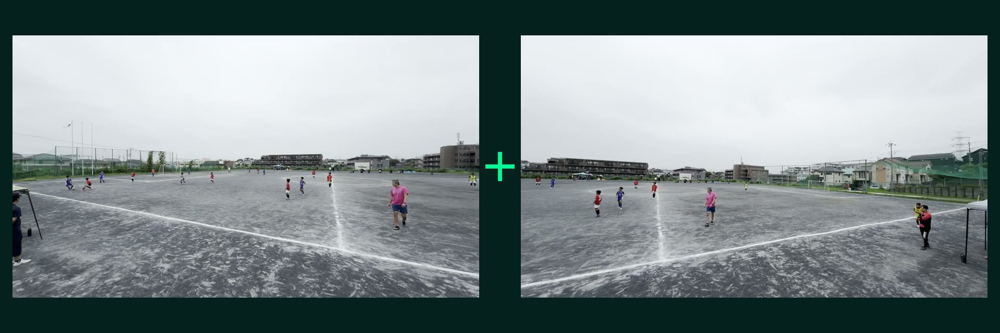

Para filmar um jogo de futebol infantil, existem cinco caminhos principais: **um celular, uma câmera que segue a bola sozinha, uma câmera 360°, uma câmera de ação ou dois iPhones fazendo um vídeo panorâmico**. A escolha depende de duas perguntas. **Se você quer o jogo inteiro, escolha algo que fique parado e filme bem aberto.** **Se você quer ver seu filho de perto, escolha algo em que dê para dar zoom depois.** Neste post, comparamos no que cada opção é boa e o que pede cuidado: como posicionar, quanto do campo aparece, se dá para dar zoom depois e como funcionam os custos.

## Resumindo: jogo inteiro, câmera parada e aberta; seu filho, zoom depois

Nos vídeos de jogo, dois problemas aparecem o tempo todo.

- **O jogo inteiro não está lá**: enquanto a câmera se move, o que acontece longe da bola fica fora da imagem
- **Seu filho aparece pequeno**: quando você filma aberto, cada jogador fica pequeno

O jeito mais seguro de guardar o jogo inteiro é deixar a câmera parada e pegar o campo de ponta a ponta. Para ver seu filho de perto, ou você dá zoom na hora de filmar, ou guarda detalhes suficientes para dar zoom depois. A seguir, comparamos cada opção pensando se ela consegue as duas coisas ao mesmo tempo.

## Um celular — o mais fácil, mas você escolhe entre o campo todo e seu filho

Dá para começar só com o celular que você já tem, então é o caminho mais fácil.

- **Na mão**: você acompanha seu filho ou a bola e eles aparecem grandes. Em troca, você passa o jogo olhando para a tela e sobra pouco tempo para assistir com os próprios olhos
- **No tripé, aberto**: fica mais fácil pegar o campo todo, mas um celular só cobre toda essa largura, então cada jogador aparece pequeno

Serve bem para um primeiro teste ou para filmar só um pedaço do jogo.

## Uma câmera que segue a bola — ela acompanha o lance, e é a câmera que decide o que aparece

É uma câmera que muda a direção ou o enquadramento sozinha para acompanhar a bola e os jogadores. A maior vantagem é que ninguém precisa mover a câmera.

O ponto de atenção é que **é a câmera que decide o que mostrar**. Ela acompanha o que acontece perto da bola, mas seu filho longe da bola, ou a defesa, pode ficar fora da imagem. É preciso comprar um equipamento próprio, e a forma de cobrança muda de produto para produto, então confira o que você pagaria além do aparelho antes de comprar.

## Uma câmera 360° — pega tudo em volta, mas os pixels se dividem em todas as direções

Essa câmera filma tudo ao redor de uma vez: frente, trás e para cima. A vantagem é escolher para onde olhar depois.

Por outro lado, a câmera 360° **divide os pixels em todas as direções**, então cada direção fica com menos detalhe e os jogadores distantes aparecem pequenos. Num jogo de futebol, quase sempre você só quer o campo, e não a arquibancada atrás de você ou o céu.

## Uma câmera de ação (câmera grande-angular) — bem aberta, mas as crianças distantes ficam pequenas

Uma câmera pequena e resistente, que pega uma área ampla sozinha. Presa num tripé ou numa grade, ela filma sem ninguém mexer.

Mas, como uma câmera só cobre uma área ampla, as crianças distantes aparecem pequenas, igual ao celular aberto no tripé. Lentes grande-angulares também costumam entortar o que está perto das bordas da imagem.

## Dois iPhones lado a lado no tripé (panovi) — deixa parado, pega as duas traves e dá zoom depois

O panovi é um app que **coloca dois iPhones lado a lado num tripé e transforma as imagens da esquerda e da direita em um só vídeo panorâmico**.

- **Deixa parado**: ninguém precisa mover a câmera. Quem filma pode assistir ao jogo e torcer com os próprios olhos
- **As duas traves aparecem**: no prolongamento da linha do meio-campo, as duas traves cabem em um só vídeo
- **Zoom depois**: cada lado é gravado em 4K e os dois são unidos, então guarda mais detalhes do que uma câmera só cobrindo a mesma largura. No vídeo unido, toque duas vezes para dar zoom e arraste para os lados até chegar no seu filho
- **O que acontece longe da bola também fica**: a câmera não muda de direção, então tudo continua na imagem

Você precisa de dois iPhones, um tripé e um suporte para deixar os dois lado a lado. Pode usar um iPhone emprestado da família ou de um amigo. Se os dois iPhones tiverem lente ultra-angular, dá para filmar até cerca de 190 graus (a largura muda conforme o posicionamento).

O panovi é grátis para usar, com compras dentro do app. Não há assinatura.

## Tabela comparativa

| Opção | Pode ficar parada? | As duas traves aparecem? | Dá zoom depois? | O que precisa | Como funcionam os custos |
|---|---|---|---|---|---|
| Um celular (na mão) | Não (alguém precisa mover) | Só se você mover | Só do tamanho que filmou | Um celular | Só o que você já tem |
| Um celular (tripé) | Sim | Se filmar aberto, mas cada jogador fica pequeno | Dá, com o detalhe de uma câmera só | Celular e tripé | O que você já tem, mais um tripé |
| Câmera que segue a bola | Sim | Só o que ela acompanha | Depende do produto | Equipamento próprio | Muda de produto para produto. Confira os custos além do aparelho |
| Câmera 360° | Sim | Sim | Dá, mas os pixels se dividem em todas as direções | Uma câmera 360° | Equipamento próprio |
| Uma câmera de ação | Sim | Costuma caber, mas os distantes ficam pequenos | Dá, com o detalhe de uma câmera só | Câmera e algo para prender | Equipamento próprio |
| Dois iPhones (panovi) | Sim | Sim | Sim (4K de cada lado) | Dois iPhones, tripé e suporte | Sem câmera própria e sem assinatura. Grátis, com compras dentro do app |

## O tripé e onde colocar

Se você filma de um lugar fixo, o lugar é o que mais importa, seja qual for a câmera.

- No **prolongamento da linha do meio-campo**, as duas traves cabem de forma equilibrada
- Filmando **do lugar mais alto possível**, os jogadores da frente e do fundo se sobrepõem menos e fica mais fácil acompanhar o jogo todo. Se houver arquibancada ou barranco, use
- Escolha um lugar onde as pessoas não passem bem na frente da câmera

Para filmar com o panovi — como conferir o posicionamento, usar um terceiro iPhone como controle remoto, preparar a bateria e o espaço livre e unir o primeiro e o segundo tempo — veja “[Filme o jogo de futebol inteiro](post:whole-match)”. Para alinhar bem os dois iPhones, veja “[Como posicionar para uma emenda perfeita](post:tripod-setup)”, com fotos.

Para filmar um palco da plateia, de ponta a ponta, como numa apresentação da escola, veja “[Onde colocar o tripé para filmar a apresentação da escola?](post:recital)”. Outras dúvidas comuns estão nas nossas “[Perguntas frequentes](/pt/faq/)”.

## Perguntas frequentes

### Onde colocar a câmera para filmar um jogo de futebol?

No prolongamento da linha do meio-campo, no lugar mais alto que der. As duas traves cabem de forma equilibrada, e os jogadores da frente e do fundo se sobrepõem menos. Se houver arquibancada ou barranco, use.

### O que é melhor: uma câmera que segue a bola ou uma câmera parada que filma bem aberto?

Depende do que você quer guardar. Se quer ver grande o que acontece perto da bola, a câmera que segue a bola combina mais. Se quer guardar tudo — o que acontece longe da bola e o posicionamento do seu filho —, combina mais uma câmera parada que filma de ponta a ponta, com zoom depois.

### A bateria do celular aguenta o jogo inteiro?

Depende do modelo, da temperatura e da duração do jogo. No panovi, use a economia de energia durante a gravação para apagar a tela e a bateria render mais. Num jogo longo, ligar um carregador portátil deixa você mais tranquilo.

### O que é preciso cuidar ao filmar o jogo do meu filho?

Primeiro, confira as regras de filmagem do time, do torneio e do local. Alguns lugares não permitem tripé ou só deixam filmar de uma área definida. Antes de mostrar o vídeo para o time ou publicar na internet, peça permissão para as pessoas que aparecem nele.

## Leia também

- [Filme o jogo de futebol inteiro — onde colocar, controle remoto e bateria](post:whole-match)
- [Como posicionar para uma emenda perfeita — o tripé e o segredo do “V”](post:tripod-setup)
- [Primeiros passos com o panovi — até o seu primeiro vídeo](post:first-video)

{{appstore}}
