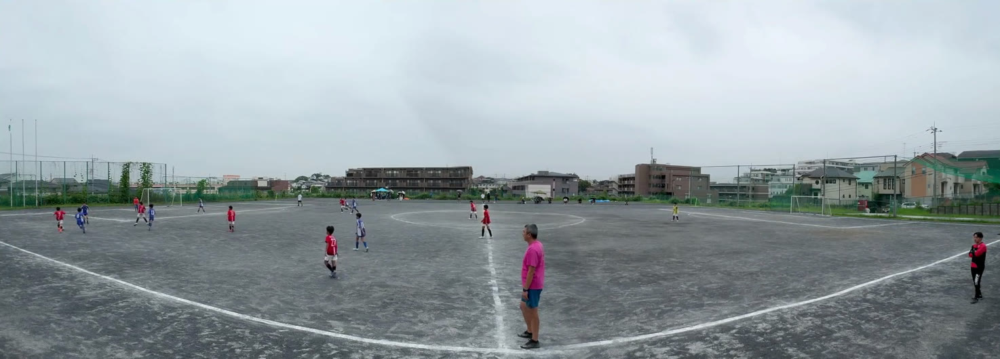
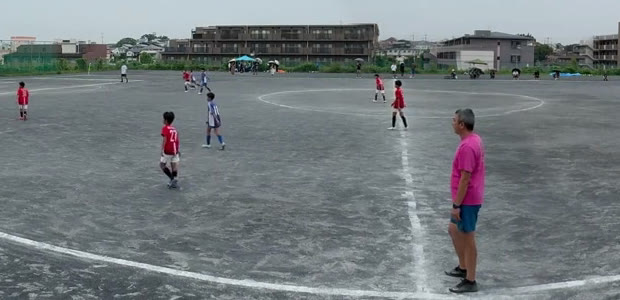

少年サッカーの試合をスマホで撮ると、「子どもが小さくしか映っていない」「ボールを追っているうちに大事な場面を逃した」「撮るのに必死で、試合を見ていなかった」ということがよくあります。うまく撮れるかどうかは、スマホの性能よりも、**どこに、どの高さで、どう置くか**で大きく変わります。この記事では、立つ位置・高さ・設定・当日の持ち物の順に、スマホで試合を撮るコツをまとめます。

## 結論：ハーフウェーラインの延長に、高く、三脚で

先に答えを書くと、次の3つです。

- **立つ位置**は、ハーフウェーライン（センターライン）を外へのばしたあたり
- **高さ**は、できるだけ高いところから
- **スマホは三脚に固定**して、ズームはほどほどに

ここから、ひとつずつ理由を説明します。

## 立つ位置：ハーフウェーラインの延長がいちばん

- **ハーフウェーラインの延長**：左右のゴールまでの距離が同じになるので、どちらの攻めも同じくらいの大きさで映ります。いちばんのおすすめです
- **コーナーのうしろ**：ななめからグラウンドを見るので、奥行きが出ます。ただ、遠いほうのゴールはとても小さくなります
- **ゴールのうしろ**：シュートの場面は迫力がありますが、反対側のゴールはほとんど見えません。試合全体を残すのには向きません

どこに立つにしても、ベンチのまわりや審判が動くところには近づきすぎないようにしましょう。

## 高さ：高いほど、全体の動きがわかる

同じ場所でも、低いところから撮ると、手前の選手のうしろに奥の選手がかくれてしまいます。高いところから見下ろすように撮ると、重なりが減って、選手がどこにいるのか、どう動いているのかが見やすくなります。

- スタンドや土手、段差があれば使いましょう
- 三脚は、のばせるところまでのばします。背の高い三脚ほど、風であおられやすくなります。脚を大きく広げ、試合中は近くからはなれないようにしましょう
- 場所は早めに決めて、うしろの人が見るじゃまにならないところを選びます

## 設定：なめらかさを優先する

iPhone なら、「設定」→「カメラ」→「ビデオ撮影」で、撮る大きさ（解像度）となめらかさ（fps）を選べます。

- サッカーは動きが速いので、**60 fps** にすると、ボールや選手の動きがなめらかになります
- **4K** にすると、あとで寄って見たときにも細かさが残ります。そのかわり、空き容量を多く使います。同じ画面に出る容量の目安を見て、空き容量と相談して決めましょう
- 撮りはじめる前に、レンズをふいておきましょう。指のあとがあると、全体がぼやけます

## ズームと追い方：ズームしすぎない

遠くの子どもを大きく撮りたくて、ズームを上げたくなります。でも、ズームを上げるほど画面に入る範囲がせまくなり、ボールが外に出たとき、どこに行ったかわからなくなります。手もとが少し動いただけで、画面も大きくゆれます。

- ズームは**少しだけ**にして、ボールのまわりの選手の位置がわかるくらいに引いて撮りましょう
- 三脚にのせたまま、ボールに合わせて**ゆっくり左右に振る**と、見やすい映像になります
- 前半と後半は、それぞれ途中で止めずに撮りつづけると、あとで見返すときに場面を探しやすくなります

## スマホ1台だと、「全体」か「わが子」かを選ぶことになる

ここまでのコツで、ずいぶん見やすく撮れるようになります。それでも、1台のスマホでは、どうしても選ばなければならないことがあります。

- **全体を入れる**と、一人ひとりは小さくなる
- **わが子に寄る**と、ボールから離れたところで起きたことは映らない
- **カメラを振る**と、撮る人は試合を自分の目で見られない

この3つを一度に解決したいときは、撮り方を変える方法があります。

## もう1台あれば：置いたまま全体を撮って、あとから寄る

panovi（パノビ）は、**2台のiPhoneを三脚に並べて置き、左右の映像を1本のパノラマ動画にする**アプリです。

- ハーフウェーラインの延長に置けば、**両ゴールまでが1本の映像**に入ります
- カメラを振らないので、**撮る人も試合を見て応援できます**
- 左右それぞれを4Kで撮ってつなぐので、1台で同じ広さを撮るより細かく残ります。撮ったあと、**ダブルタップで寄って**、ドラッグでわが子のところへ動かして見られます

2台目は、家族のiPhoneを借りてもかまいません。panovi は基本無料で使えます（アプリ内課金あり）。くわしくは [App Store](https://apps.apple.com/jp/app/id6797261654) で。

iPhoneが1台しかないときは、広角と超広角で同時に録る「1台で撮る」もあります（「[iPhone 1台でも撮れるようになりました](post:one-iphone)」）。

panovi で試合を撮るときの段取りは「[少年サッカーの試合を三脚でまるごと撮る](post:whole-match)」に、道具ごとの比べは「[少年サッカーの試合撮影、何で撮る？](post:soccer-camera)」にまとめました。

## 当日の持ち物チェックリスト

**前の日**

- スマホを満充電にする
- 空き容量を確かめる。いらない動画や写真を片付けておく
- モバイルバッテリーを充電しておく

**持っていくもの**

- スマホ
- 三脚（高くのばせるもの）
- モバイルバッテリーとケーブル
- レンズをふく布
- 寒い日は画面をさわれる手袋。暑い日は、スマホが日なたで熱くなりすぎないようにする工夫

**会場で、キックオフの前に**

- 撮影のきまり（三脚を使ってよいか、撮ってよい場所）を確かめる
- 立つ場所を決めて、三脚を立てる。目の前を人が通りにくいか見る
- 少しだけ試しに撮って、両ゴールの方向まで入るか、明るさは大丈夫か見る
- 録画中に電話や通知の表示が出ないように、集中モード（おやすみモードなど）にしておく

**ハーフタイム**

- 電池と空き容量を見る。足りなければバッテリーをつなぐ

## 撮影のきまりとマナー

- 大会や会場、チームによって、撮影や三脚の使い方にきまりがあります。まず確かめましょう
- 撮った動画をチームの人に送ったり、インターネットに上げたりするときは、写っている子どもや家族の許可をとってからにしましょう
- 三脚や荷物で、選手・審判・ほかの観客の通り道をふさがないようにしましょう

## よくある質問

### スマホで少年サッカーの試合を撮るなら、どこに立てばいいですか？

ハーフウェーラインを外へのばしたあたりの、なるべく高いところがおすすめです。左右のゴールが同じくらいの大きさで映り、手前と奥の選手の重なりも減ります。

### ズームは使ってもいいですか？

少しだけにしましょう。ズームを上げるほど画面に入る範囲がせまくなり、ボールを見失いやすく、ゆれも大きくなります。わが子を大きく見たいときは、全体を細かく撮っておいて、あとから寄る方法もあります。

### 三脚はなくても撮れますか？

撮れますが、手で持ったままだと腕がつかれて、だんだん画面がゆれてきます。試合を最後まで撮るなら、三脚をおすすめします。

### 試合を最後まで撮ると、電池はもちますか？

機種や気温、試合の長さで変わります。前の日に満充電にして、モバイルバッテリーをつなげるようにしておくと安心です。

## 次に読む

- [少年サッカーの試合撮影、何で撮る？ — ピッチ全体を取りこぼさないカメラ比べ](post:soccer-camera)
- [少年サッカーの試合を三脚でまるごと撮る — 置き場所・リモコン・電池の段取り](post:whole-match)
- [きれいにつながる置き方 — 三脚と「ハの字」のコツ](post:tripod-setup)

{{appstore}}
