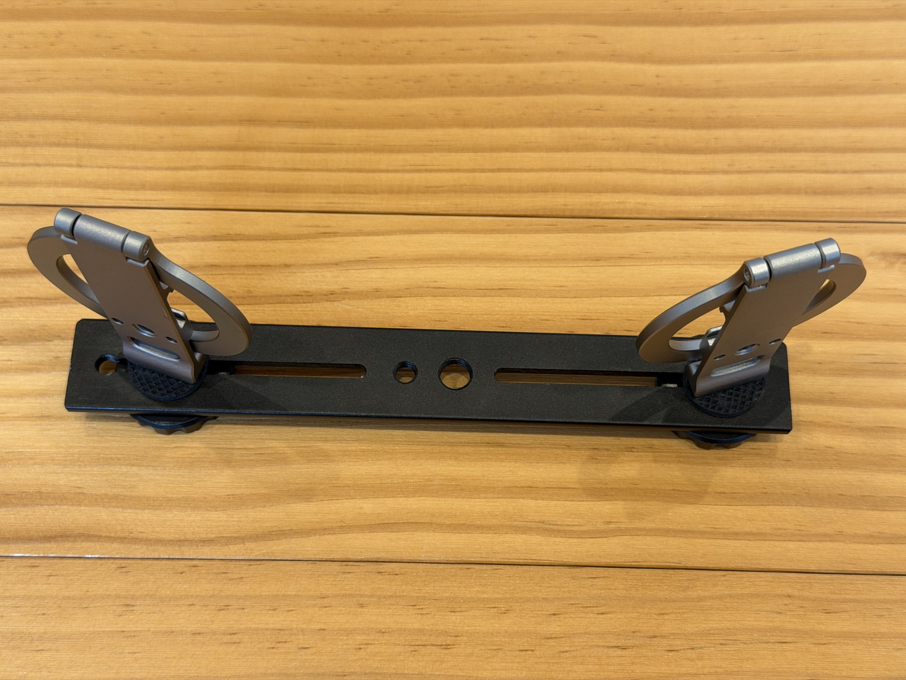
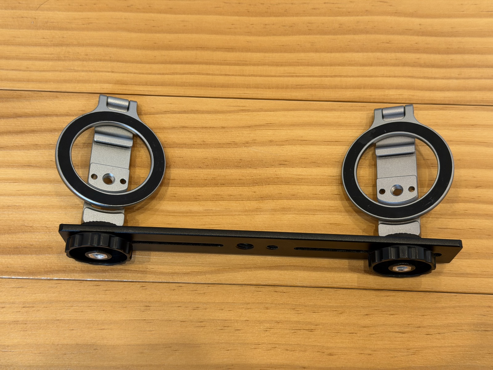

How your panovi video turns out is mostly decided by how you place the iPhones before you shoot. That said, there isn't much to do. This post covers setting up the tripod and a few tips for placing the iPhones so the seam looks clean.

## How to build the tripod rig

Take any tripod you own, put one [dual bracket plate (Amazon)](https://www.amazon.co.jp/dp/B0HFZNJWCX?tag=petanote-22) on it, and screw on two [MagSafe tripod mounts (Amazon)](https://link.amazon/B0cYKJkFr). No tools needed.

The iPhones snap on with magnets, so mounting and removing them on site takes a second. If you keep a case on, choose a MagSafe-compatible case.

## Tip 1: Bring the lenses together near the center

Set the two iPhones side by side, **turned so their lenses meet near the center**. Seen from above, the two form a shallow V.

The farther apart the lenses are, the more the left and right views differ, and the more easily the seam goes out of line. The closer they are, the cleaner the stitch.

## Tip 2: Angle them slightly inward to create an overlap

The left and right footage need to **overlap a little at their inner edges**. The app uses that overlapping area to line the two up.

Angle both iPhones slightly inward, so the same scenery shows up at the inner edge of each. Tap **"Check the setup"** and the screen tells you how far to turn them. If it says to turn them a bit more inward, adjust them as it says.

## Tip 3: Use "Preview 3 seconds of motion" before the real thing

Once they are placed, tap **"Preview 3 seconds of motion"**. It stitches a 3-second test clip on the spot and shows it to you, so you can check before recording that the seam is clean and nothing is tilted. This check is free, and you can use it as often as you like.

## Tip 4: Keep things that are too close away from the seam

The seam sits in the middle of the frame. If a person or object passes right in front of the camera there, the left and right views differ more, and the seam is more likely to look out of line.

- Set up the tripod a little farther back from what you want to film
- When filming through a fence or net, step back a little instead of standing right up against it

That alone makes the seam much less noticeable.

## If it didn't work out

- **The tripod moved partway through**: you can split the recording at that point and stitch again
- **You see a band of brightness in smooth areas like the sky**: on the stitch screen, try switching "Matching colour at the seam"
- **You don't like the result**: use "Redo the stitch" to stitch it again a different way

## Read next

- [Getting started with panovi — shooting your first video](post:first-video)
- [Borrow a second iPhone. When lending yours, use Guided Access for peace of mind](home:#lend)

{{appstore}}
