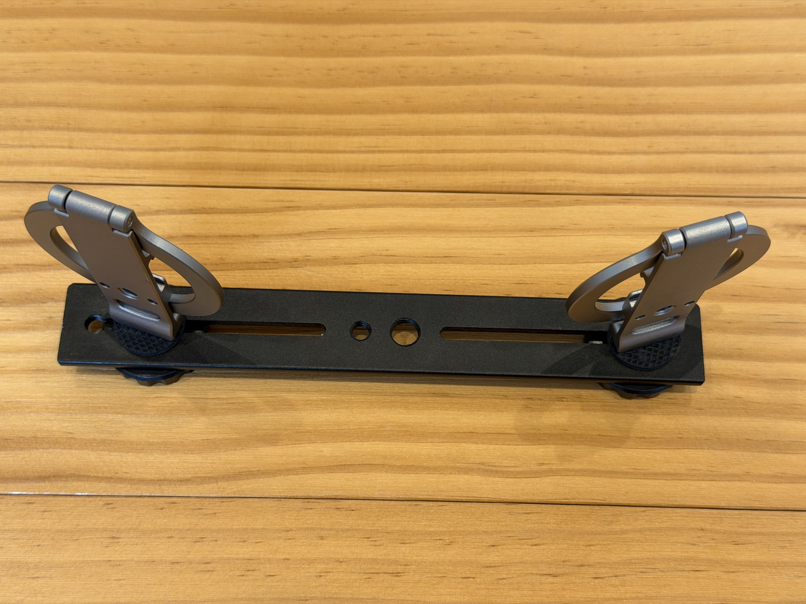
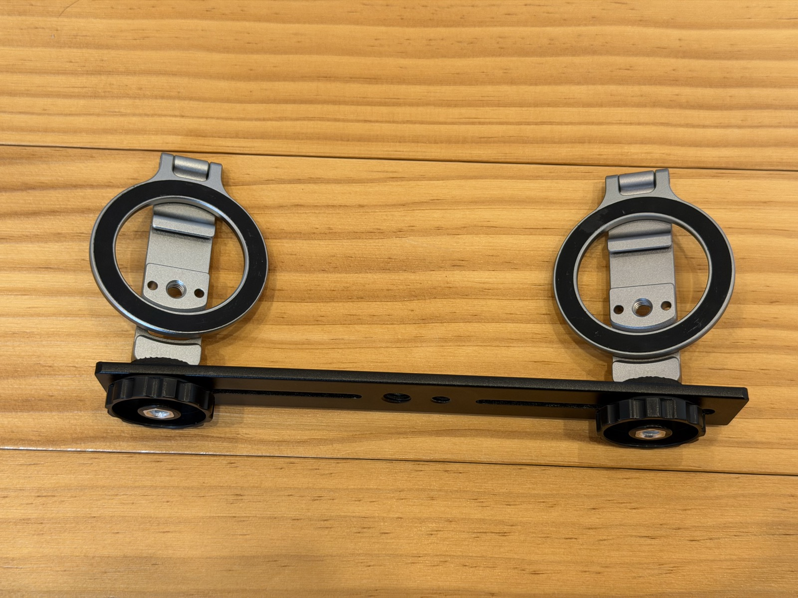
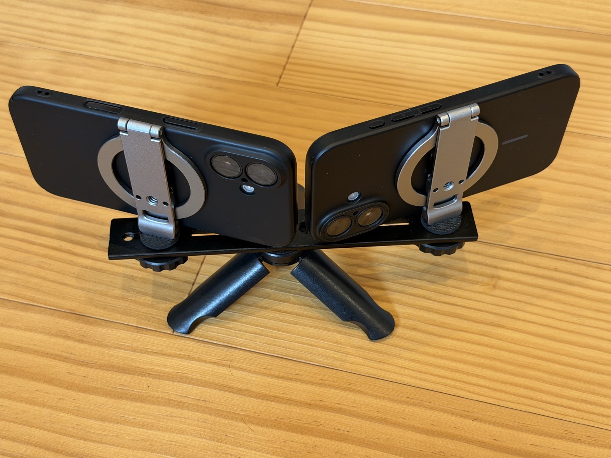

El resultado de panovi depende casi por completo de cómo colocas los iPhone antes de grabar. Pero no hay mucho que hacer. En este artículo te mostramos cómo preparar el trípode y algunos trucos para que la unión se vea limpia.

## Cómo armar el trípode

Toma cualquier trípode que tengas, ponle una [placa doble (Amazon)](https://www.amazon.co.jp/dp/B0HFZNJWCX?tag=petanote-22) y atorníllale dos [soportes MagSafe para trípode (Amazon)](https://link.amazon/B0cYKJkFr). Eso es todo. No necesitas herramientas.

Los iPhone se pegan con imán, así que ponerlos y quitarlos en el lugar toma un segundo. Si los usas con funda, elige una compatible con MagSafe.

## Truco 1: junta las cámaras cerca del centro

Pon los dos iPhone **con las cámaras juntas cerca del centro**. Vistos desde arriba, forman una V abierta.

Cuanto más separadas están las cámaras, más diferente se ve la escena desde cada lado, y más fácil es que la unión se desfase. Cuanto más juntas, más limpia queda.

## Truco 2: gíralos un poco hacia adentro para que se superpongan

Las imágenes de la izquierda y de la derecha **tienen que superponerse un poco en sus bordes interiores**. La app usa esa zona en común para alinearlas.

Gira los dos iPhone un poco hacia adentro, para que el mismo paisaje aparezca en el borde interior de los dos. Para saber cuánto girarlos, toca **“Verificar alineación”** y la pantalla te lo dirá. Si te pide girarlos un poco más hacia adentro, hazle caso.

## Truco 3: antes de grabar, “Ver 3 segundos de movimiento”

Cuando estén colocados, toca **“Ver 3 segundos de movimiento”**. La app une al momento un video de prueba de solo 3 segundos y te lo muestra, así que antes de grabar puedes revisar que la unión se vea limpia y que la imagen no esté inclinada. Esta prueba es gratis y puedes usarla las veces que quieras.

## Truco 4: no dejes nada demasiado cerca de la zona de unión

La unión queda en el centro de la imagen. Si ahí pasan personas u objetos muy cerca de la cámara, la escena se ve muy diferente desde cada lado y es más fácil que se note el desfase.

- Pon el trípode un poco lejos de lo que quieres grabar
- Si grabas a través de una reja o una red, aléjate un poco de ella

Solo con eso, la unión se nota mucho menos.

## Si algo no salió bien

- **El trípode se movió a mitad de la grabación**: puedes dividir la unión en ese punto y volver a unir
- **Se ve una franja de brillo en zonas lisas, como el cielo**: en la pantalla de unión, prueba otra opción de “Ajuste de color en la unión”
- **No te gusta el resultado**: con “Volver a unir” puedes unirlo de nuevo con otro método

## Sigue leyendo

- [Tu primer video con panovi — paso a paso](post:first-video)
- [El segundo iPhone puede ser prestado. Al prestarlo, usa Acceso guiado para estar tranquilo](home:#lend)

{{appstore}}
