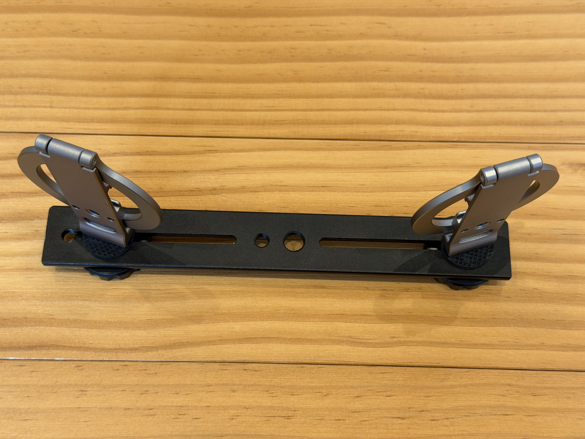
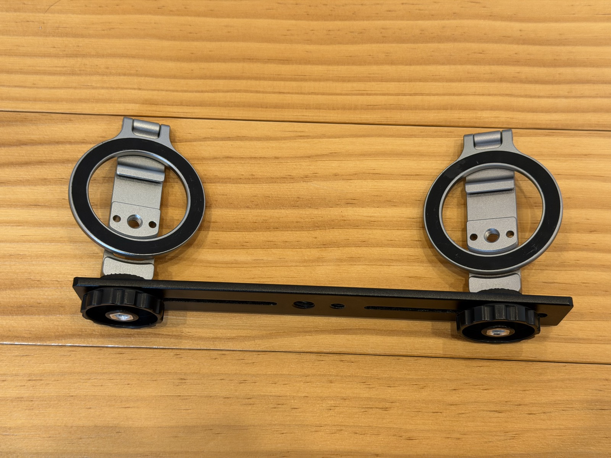

panovi の仕上がりは、撮る前の置き方でほぼ決まります。といっても、やることは多くありません。この記事では、三脚の用意と、つなぎ目をきれいにする置き方のコツを紹介します。

## 三脚のつくり方

お手持ちの三脚1本に、[2台用のブラケットプレート（Amazon）](https://www.amazon.co.jp/dp/B0HFZNJWCX?tag=petanote-22)を1枚のせ、[MagSafe対応の三脚マウント（Amazon）](https://link.amazon/B0cYKJkFr)を2個ねじ止めするだけです。工具はいりません。

iPhoneは磁石でパチッと着くので、現場での載せ外しも一瞬です。ケースを付けたままにするなら、MagSafe対応のケースを選んでください。

## コツ1：レンズどうしを、中央で近づける

2台は**レンズどうしが中央で近づく向き**に並べます。上から見ると、2台がゆるい「ハの字」になる置き方です。

レンズが離れているほど、左右の見え方の差が大きくなり、つなぎ目がずれやすくなります。近づけるほどきれいにつながります。

## コツ2：少し内側へ向けて、重なりを作る

左右の映像は、**内側の端どうしが少し重なっている**必要があります。重なった部分を手がかりに、アプリが位置を合わせるからです。

2台を少し内側へ向けて、同じ景色が両方の内側の端に写るようにします。どのくらい向ければよいかは、**「配置を確認」**を押すと画面が教えてくれます。「もう少し内側へ」と出たら、そのとおりに直してください。

## コツ3：本番の前に「3秒で動きを確認」

置けたら、**「3秒で動きを確認」**を押します。3秒だけの確認用の動画をその場でつないで見せてくれるので、つなぎ目がきれいか、傾いていないかを録画の前に確かめられます。この確認は無料で、何度でも使えます。

## コツ4：つなぎ目のあたりに、近すぎるものを置かない

つなぎ目は画面の真ん中にきます。そこに、カメラのすぐ近くを通る人や物が来ると、左右の見え方の差が大きくなり、ずれて見えやすくなります。

- 撮りたいものから、少し離れた場所に三脚を立てる
- 柵やネット越しに撮るときは、柵の目の前より少し下がる

これだけで、つなぎ目はぐっと目立たなくなります。

## うまくいかなかったときは

- **途中で三脚が動いてしまった**：区切り直して結合できます
- **空のようななめらかな所に、明るさの帯が見える**：結合の画面の「継ぎ目の色の合わせ方」を切り替えて試してください
- **結果が気に入らない**：「結合をやり直す」から、別の方法でつなぎ直せます

## 次に読む

- [はじめての panovi — 最初の1本を撮るまで](post:first-video)
- [2台目は借りたiPhoneで。貸すときは「アクセスガイド」で安心](home:#lend)

{{appstore}}
