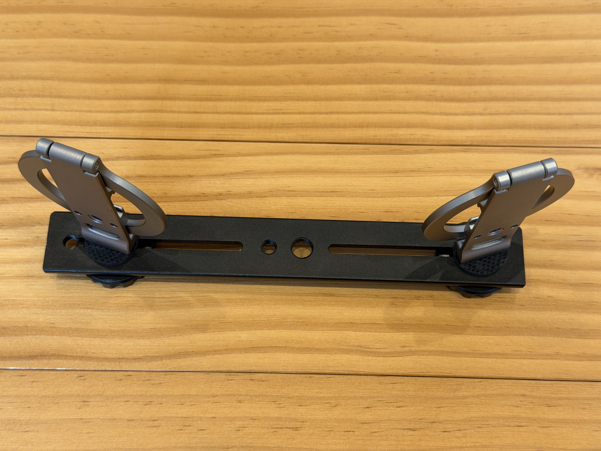
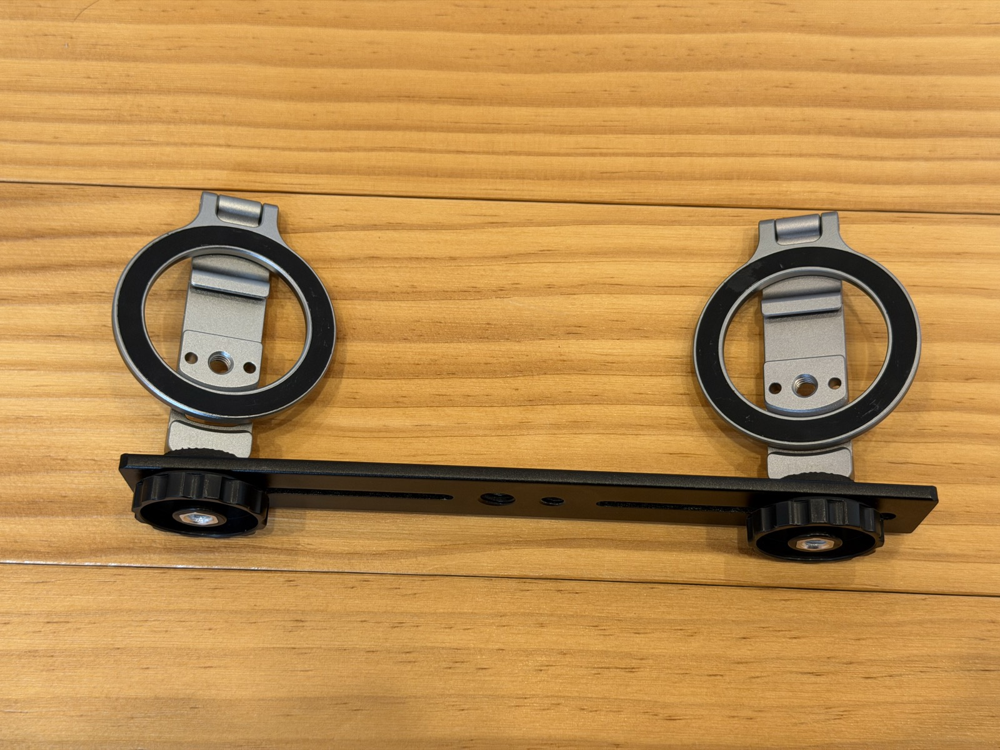

O resultado do panovi depende quase todo de como você posiciona os iPhones antes de gravar. Mas não há muito o que fazer. Neste artigo, mostramos como preparar o tripé e os segredos para a emenda ficar bonita.

## Como montar o tripé

Use qualquer tripé que você tenha, coloque nele uma [placa dupla (Amazon)](https://www.amazon.co.jp/dp/B0HFZNJWCX?tag=petanote-22) e parafuse dois [suportes MagSafe para tripé (Amazon)](https://link.amazon/B0cYKJkFr). Só isso. Não precisa de ferramentas.

Os iPhones se prendem com ímã num clique, então colocar e tirar na hora leva um segundo. Se for usar capinha, escolha uma compatível com MagSafe.

## Segredo 1: deixe as lentes bem próximas, no centro

Coloque os dois iPhones **com as lentes bem próximas, no centro**. Vistos de cima, os dois formam um “V” bem aberto.

Quanto mais longe as lentes estiverem uma da outra, maior a diferença entre o que cada lado vê, e mais fácil a emenda sair desalinhada. Quanto mais próximas, melhor a união.

## Segredo 2: vire um pouco para dentro e crie uma sobreposição

As imagens da esquerda e da direita precisam **se sobrepor um pouco nas bordas internas**. O app usa essa parte em comum como referência para alinhar as imagens.

Vire os dois um pouco para dentro, para que a mesma cena apareça nas bordas internas dos dois. Para saber quanto virar, toque em **“Verificar alinhamento”** e a tela orienta você. Se aparecer um aviso pedindo para virar mais para dentro, é só ajustar.

## Segredo 3: antes de gravar, use “Ver 3 segundos de movimento”

Com tudo no lugar, toque em **“Ver 3 segundos de movimento”**. O app une na hora um vídeo de teste de só 3 segundos e mostra o resultado. Assim você confere, antes de gravar, se a emenda está boa e se a imagem não está torta. Essa prévia é grátis e você pode usar quantas vezes quiser.

## Segredo 4: nada muito perto da câmera na altura da emenda

A emenda fica no meio da tela. Se uma pessoa ou um objeto passar bem perto da câmera nesse ponto, a diferença entre o que cada lado vê aumenta, e a emenda tende a parecer desalinhada.

- Monte o tripé um pouco afastado do que você quer filmar
- Se for filmar através de uma grade ou rede, dê alguns passos para trás em vez de ficar colado nela

Só isso já deixa a emenda muito menos visível.

## Se algo não der certo

- **O tripé se mexeu no meio da gravação**: dá para dividir a gravação no momento em que ele se mexeu e unir de novo
- **Aparece uma faixa de brilho em áreas lisas, como o céu**: na tela de união, mude a opção “Ajuste de cor na emenda” e veja como fica
- **Não gostou do resultado**: em “Refazer a união”, você pode unir de novo de outro jeito

## Leia também

- [Primeiros passos com o panovi — até o seu primeiro vídeo](post:first-video)
- [O segundo iPhone pode ser emprestado. Ao emprestar, use o Acesso Guiado](home:#lend)

{{appstore}}
