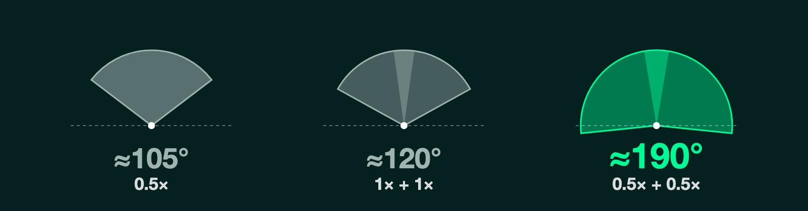

panovi can now **turn about 190° into one panoramic video with two iPhones set to Ultra Wide**. While facing forward, everything from your right side to your left side — and a little behind both — goes into one video. One iPhone's Ultra Wide camera covers about 105°, so this is close to twice as wide.

")

## How wide is it?

We compared how much each setup captures. The numbers were measured on videos we shot and saved in our tests. They change a little depending on how you set the iPhones up.

| Setup | Horizontal coverage |
|---|---|
| One iPhone, Ultra Wide (0.5×) | About 105° |
| Two iPhones, Wide (1×) | About 120° |
| Two iPhones, Ultra Wide (0.5×) | **About 190°** |

180° is “from straight right to straight left”, so 190° is a little more: it reaches **just behind your shoulders**. In a gym that means from one end wall to the other; on a field, behind both goals — all in one video, without moving the camera.

## Why this is a big deal

### One iPhone can never reach it

The widest lens on an iPhone is the Ultra Wide, and it covers about 105°. It can’t see straight to the side. 190° is simply out of reach for a single iPhone.

### The wider you angle two iPhones, the harder they are to join

Angling the two iPhones far outward makes the picture wider, but **the strip both of them see (the overlap) gets thinner**. In our setup the overlap was about 19°. The app uses this overlap to line up the two videos, so less overlap means fewer clues.

### Nearby things look slightly shifted between the two

The two lenses are a few centimeters apart. So **the closer something is, the more its position differs between the left and right videos** (this is called parallax). The Ultra Wide camera sees things close to your feet, so this shift creeps in easily.

Until now, a setup that connected in the check before shooting could still fail to stitch afterward because of this shift. You then had to choose “Try another alignment method”.

Now panovi **lines up the two videos while allowing for this shift**. If the setup check connects, the recording stitches with “Normal” too. And because each side is recorded in 4K, you keep more detail than one iPhone shooting the same width.

## How to shoot it

1. Set the lens to **Ultra Wide** on both iPhones (available when both iPhones have an Ultra Wide camera)
2. Angle the two iPhones **further outward** than you would for Wide. Seen from above, the difference between their directions is close to a right angle. Keep the lenses close together in the center as usual
3. Tap **“Check the setup”** and look at “Coverage” and “Overlap” on the screen. In our test it connected at a coverage of about 190° and an overlap of about 18–19%
4. Once it connects, record and stitch as usual

The basics of placing the iPhones are in [Placing your iPhones for a clean stitch](post:tripod-setup|home:#how).

## Things to keep in mind

- **Width versus detail**: the same 4K is spread over a wider view, so there is less detail per degree than with two iPhones on Wide. To zoom in a lot on a child far away later, use two on Wide (about 120°). To keep the whole place, use two on Ultra Wide (about 190°)
- **Keep very close objects away from the seam**: anything closer than 1–2 m right at the seam can make the shift visible
- **Lines bend at the edges**: 190° is spread flat into one picture, so straight fences and lines look curved near the left and right edges, just like in a panorama photo

## Frequently asked questions

### Can one iPhone capture 190°?

No. One iPhone’s Ultra Wide covers about 105°. For 190° you need two iPhones set to Ultra Wide.

### Which iPhones does this work with?

It works when both iPhones have an Ultra Wide camera. If one doesn’t, both record on Wide (about 120°).

### Does it change the price or how long I can record?

No. Pricing and recording time are the same as with the usual two-iPhone setup. panovi is free to use, with in-app purchases.

## Read next

- [Placing your iPhones for a clean stitch — the tripod and the shallow V](post:tripod-setup)
- [Getting started with panovi — shooting your first video](post:first-video)

{{appstore}}
