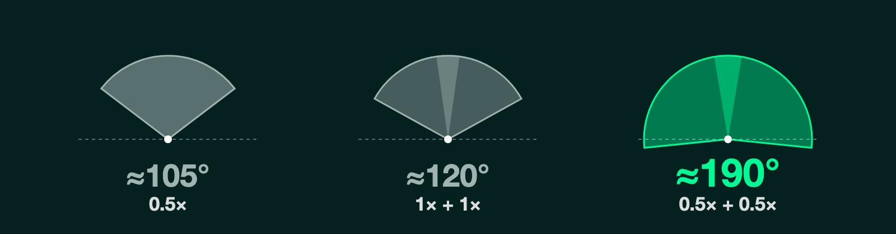

panovi ahora puede **convertir cerca de 190° en un solo video panorámico con dos iPhone en ultra gran angular**. Mirando al frente, todo desde tu costado derecho hasta tu costado izquierdo — y un poco detrás de ambos — entra en un solo video. El ultra gran angular de un iPhone cubre cerca de 105°, así que es casi el doble de ancho.

")

## ¿Qué tan ancho es?

Comparamos cuánto graba cada configuración. Los números se midieron en videos que grabamos y guardamos en nuestras pruebas. Cambian un poco según cómo coloques los iPhone.

| Configuración | Ancho horizontal |
|---|---|
| Un iPhone, ultra gran angular (0.5×) | Cerca de 105° |
| Dos iPhone, gran angular (1×) | Cerca de 120° |
| Dos iPhone, ultra gran angular (0.5×) | **Cerca de 190°** |

180° es “desde el costado derecho hasta el costado izquierdo”, así que 190° es un poco más: llega **un poco detrás de tus hombros**. En un gimnasio, de una pared del fondo a la otra; en una cancha, detrás de las dos porterías — todo en un solo video, sin mover la cámara.

## Por qué es importante

### Un solo iPhone nunca llega

El lente más abierto del iPhone es el ultra gran angular, y cubre cerca de 105°. No ve el costado. 190° está fuera del alcance de un solo iPhone.

### Cuanto más abres los dos iPhone, más difícil es unirlos

Girar los dos iPhone bien hacia afuera hace la imagen más ancha, pero **la franja que ven los dos (la superposición) se vuelve más delgada**. En nuestra configuración, la superposición era de cerca de 19°. La app usa esa superposición para alinear los dos videos, así que menos superposición significa menos pistas.

### Los objetos cercanos se ven un poco desplazados entre los dos

Los dos lentes están a unos centímetros uno del otro. Por eso, **cuanto más cerca está algo, más cambia su posición entre el video izquierdo y el derecho** (esto se llama paralaje). El ultra gran angular muestra hasta cosas cerca de tus pies, así que este desplazamiento aparece con facilidad.

Hasta ahora, una colocación que conectaba en la verificación antes de grabar todavía podía fallar al unir después, por este desplazamiento. Entonces había que elegir “Probar otro método de alineación”.

Ahora panovi **alinea los dos videos teniendo en cuenta este desplazamiento**. Si la verificación de alineación conecta, la grabación también se une con “Normal”. Y como cada lado se graba en 4K, conservas más detalle que un iPhone grabando el mismo ancho.

## Cómo grabarlo

1. Pon el lente en **Ultra gran angular** en los dos iPhone (disponible cuando los dos iPhone tienen cámara ultra gran angular)
2. Gira los dos iPhone **más hacia afuera** que en gran angular. Vistos desde arriba, la diferencia entre sus direcciones es cercana a un ángulo recto. Mantén los lentes juntos en el centro, como siempre
3. Toca **“Verificar alineación”** y mira “Cobertura” y “Superposición” en la pantalla. En nuestra prueba conectó con una cobertura de cerca de 190° y una superposición de cerca de 18–19%
4. Cuando conecte, graba y une como siempre

Lo básico para colocar los iPhone está en [Cómo colocarlos para una unión limpia](post:tripod-setup|home:#how).

## Lo que conviene saber

- **Ancho o detalle**: los mismos 4K se reparten en una vista más ancha, así que hay menos detalle por grado que con dos iPhone en gran angular. Para hacer mucho zoom después en un niño lejos, usa dos en gran angular (cerca de 120°). Para guardar todo el lugar, usa dos en ultra gran angular (cerca de 190°)
- **No dejes objetos muy cercanos en la unión**: algo a menos de 1–2 m justo en la unión puede hacer visible el desplazamiento
- **Las líneas se curvan en los bordes**: 190° se extiende en una sola imagen plana, así que las rejas y líneas rectas se ven curvas cerca de los bordes, como en una foto panorámica

## Preguntas frecuentes

### ¿Un solo iPhone puede grabar 190°?

No. El ultra gran angular de un iPhone cubre cerca de 105°. Para 190° necesitas dos iPhone en ultra gran angular.

### ¿Con qué iPhone funciona?

Funciona cuando los dos iPhone tienen cámara ultra gran angular. Si uno no la tiene, los dos graban en gran angular (cerca de 120°).

### ¿Cambia el precio o el tiempo de grabación?

No. Grabar es gratis por cualquier duración, y unir videos de menos de 3 minutos siempre es gratis y sin límite.

## Sigue leyendo

- [Cómo colocarlos para una unión limpia — el trípode y la forma de V](post:tripod-setup)
- [Tu primer video con panovi — paso a paso](post:first-video)

{{appstore}}
