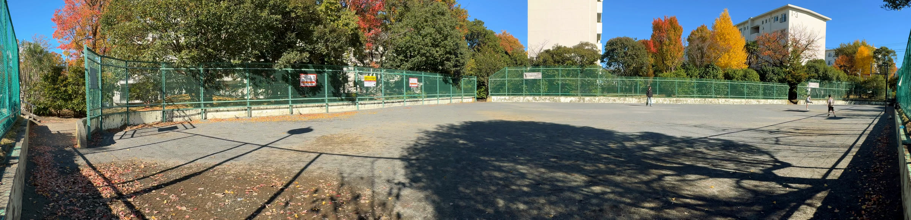
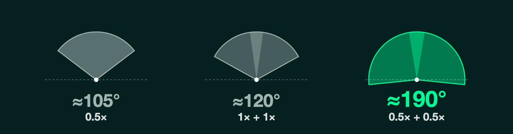

panovi で、**超広角のiPhone 2台を使うと、約190度を1本のパノラマ動画に**できるようになりました。正面を向いたまま、自分の右の真横から左の真横、さらに少し後ろまでが、1本の動画に入ります。iPhone 1台の超広角で写るのは約105度なので、およそ2倍近い広さです。

## どれくらい広い？

写る広さを、レンズと台数で比べました。数字は、私たちが試し撮りして保存した動画で測った値です。置き方で少し変わります。

| 撮り方 | 横に写る広さ |
|---|---|
| iPhone 1台・超広角（0.5×） | 約105度 |
| iPhone 2台・広角（1×） | 約120度 |
| iPhone 2台・超広角（0.5×） | **約190度** |

180度が「右の真横から左の真横まで」なので、190度はそれより少し広く、**肩の少し後ろまで**入ります。体育館なら端の壁から反対の端の壁まで、グラウンドなら両側のゴール裏まで、カメラを振らずに1本に残せます。

## なぜすごいのか

### 1台では、どうやっても届かない

iPhone でいちばん広く写るのは超広角レンズで、それでも約105度です。真横は写りません。190度は、1台のiPhoneでは届かない広さです。

### 2台を大きく開くほど、つなぐのが難しくなる

2台を外へ大きく開くと、広く写る代わりに、**2台に同じ景色が写る部分（重なり）が細く**なります。今回の置き方では、重なりは約19度でした。アプリはこの重なりを手がかりに2本の位置を合わせるので、手がかりが少ないほど難しくなります。

### 近くの物は、左右で少しずれて見える

2台のレンズは数センチ離れています。そのため、**近くの物ほど、左右の映像で少しずれた位置に写ります**（視差といいます）。超広角は足もとや近くの物まで広く写すので、このずれが入りやすくなります。

これまでは、撮る前の配置の確認ではつながったのに、撮ったあとの結合では、このずれのせいで失敗することがありました。そのときは「別の方法で位置を合わせる」を選び直す必要がありました。

いまは、**このずれを見込んで位置を合わせる**ようにしました。配置の確認でつながれば、撮ったあとも「ふつう」の結合でそのままつながります。しかも左右それぞれ4Kで撮るので、1台で同じ広さを撮るより細かく残ります。

## 撮り方

1. 2台とも、レンズを**超広角**にします（2台とも超広角カメラのあるiPhoneのとき選べます）
2. 2台の向きを、広角のときより**外へ大きく開きます**。上から見て、2台の向きの差が直角に近いくらいです。レンズどうしは、いつもどおり中央で近づけます
3. **「配置を確認」**を押して、画面の「カバー範囲」と「重なり」を見ます。私たちの試しでは、カバー範囲 約190度・重なり 約18〜19% でつながりました
4. つながったら、いつもどおり録画して結合します

置き方の基本は、[きれいにつながる置き方](post:tripod-setup|home:#how)にまとめています。

## 気をつけること

- **細かさと広さの引きかえ**：同じ4Kを広い範囲に使うので、1度あたりの細かさは広角2台より下がります。遠くの子をあとで大きく寄って見たいなら広角2台（約120度）、場所全体を残したいなら超広角2台（約190度）がおすすめです
- **つなぎ目の近くに、近すぎる物を置かない**：1〜2mより近い物がつなぎ目にあると、ずれが目立つことがあります
- **端の線が曲がって見える**：190度を1枚に広げるので、まっすぐな柵や線が左右の端で曲がって見えます。パノラマ写真と同じです

## よくある質問

### iPhone 1台で190度は撮れますか？

撮れません。iPhone 1台の超広角で写るのは約105度です。190度には、超広角のiPhoneが2台いります。

### どのiPhoneで使えますか？

2台とも超広角カメラのあるiPhoneで使えます。片方に超広角がないときは、2台とも広角で撮ります（約120度）。

### 料金や撮れる時間は変わりますか？

変わりません。撮影は何分でも無料で、3分未満の結合はずっと無料・回数無制限です。

## 次に読む

- [きれいにつながる置き方 — 三脚と「ハの字」のコツ](post:tripod-setup)
- [はじめての panovi — 最初の1本を撮るまで](post:first-video)

{{appstore}}
