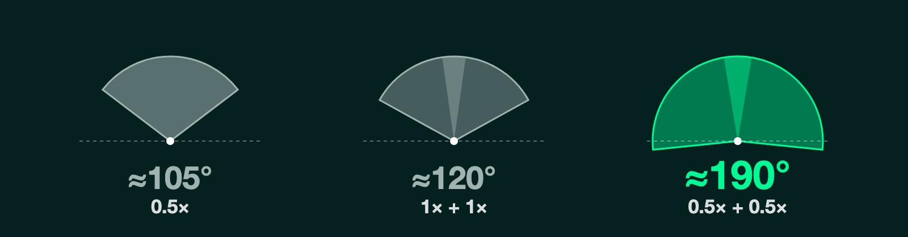

O panovi agora consegue **transformar cerca de 190° em um só vídeo panorâmico com dois iPhones na ultra-angular**. Olhando para a frente, tudo do seu lado direito ao seu lado esquerdo — e um pouco atrás dos dois — entra em um só vídeo. A ultra-angular de um iPhone cobre cerca de 105°, então é quase o dobro da largura.

")

## Quão largo é?

Comparamos o quanto cada configuração grava. Os números foram medidos em vídeos que gravamos e salvamos nos nossos testes. Mudam um pouco conforme a posição dos iPhones.

| Configuração | Largura horizontal |
|---|---|
| Um iPhone, ultra-angular (0.5×) | Cerca de 105° |
| Dois iPhones, grande-angular (1×) | Cerca de 120° |
| Dois iPhones, ultra-angular (0.5×) | **Cerca de 190°** |

180° é “da lateral direita até a lateral esquerda”, então 190° é um pouco mais: chega **um pouco atrás dos seus ombros**. Em um ginásio, de uma parede do fundo até a outra; em um campo, atrás dos dois gols — tudo em um só vídeo, sem mexer a câmera.

## Por que isso é importante

### Um iPhone sozinho nunca chega lá

A lente mais aberta do iPhone é a ultra-angular, e ela cobre cerca de 105°. Ela não vê a lateral. 190° está fora do alcance de um único iPhone.

### Quanto mais você abre os dois iPhones, mais difícil é juntar

Virar os dois iPhones bem para fora deixa a imagem mais larga, mas **a faixa que os dois veem (a sobreposição) fica mais estreita**. Na nossa configuração, a sobreposição era de cerca de 19°. O app usa essa sobreposição para alinhar os dois vídeos, então menos sobreposição significa menos pistas.

### Objetos próximos aparecem um pouco deslocados entre os dois

As duas lentes ficam a alguns centímetros uma da outra. Por isso, **quanto mais perto algo está, mais a posição dele muda entre o vídeo da esquerda e o da direita** (isso se chama paralaxe). A ultra-angular mostra até coisas perto dos seus pés, então esse deslocamento aparece com facilidade.

Até agora, uma posição que conectava na verificação antes de gravar ainda podia falhar na união depois, por causa desse deslocamento. Aí era preciso escolher “Tentar outro método de alinhamento”.

Agora o panovi **alinha os dois vídeos levando esse deslocamento em conta**. Se a verificação de alinhamento conectar, a gravação também é unida com “Normal”. E como cada lado é gravado em 4K, você guarda mais detalhes do que um iPhone gravando a mesma largura.

## Como gravar

1. Coloque a lente em **Ultra-angular** nos dois iPhones (disponível quando os dois iPhones têm câmera ultra-angular)
2. Vire os dois iPhones **mais para fora** do que na grande-angular. Vista de cima, a diferença entre as direções fica perto de um ângulo reto. Mantenha as lentes próximas no centro, como sempre
3. Toque em **“Verificar alinhamento”** e veja “Cobertura” e “Sobreposição” na tela. No nosso teste, conectou com cobertura de cerca de 190° e sobreposição de cerca de 18–19%
4. Quando conectar, grave e una como sempre

O básico de como posicionar os iPhones está em [Como posicionar para uma emenda perfeita](post:tripod-setup|home:#how).

## Pontos de atenção

- **Largura ou detalhe**: os mesmos 4K ficam espalhados por uma área maior, então há menos detalhe por grau do que com dois iPhones na grande-angular. Para dar muito zoom depois em uma criança longe, use dois na grande-angular (cerca de 120°). Para guardar o lugar inteiro, use dois na ultra-angular (cerca de 190°)
- **Não deixe objetos muito próximos na emenda**: algo a menos de 1–2 m bem na emenda pode deixar o deslocamento visível
- **Linhas curvam nas bordas**: 190° é aberto em uma só imagem plana, então grades e linhas retas parecem curvas perto das bordas, como em uma foto panorâmica

## Perguntas frequentes

### Um iPhone sozinho consegue gravar 190°?

Não. A ultra-angular de um iPhone cobre cerca de 105°. Para 190° você precisa de dois iPhones na ultra-angular.

### Com quais iPhones funciona?

Funciona quando os dois iPhones têm câmera ultra-angular. Se um deles não tiver, os dois gravam na grande-angular (cerca de 120°).

### Muda o preço ou o tempo de gravação?

Não. Gravar é grátis por qualquer tempo, e unir vídeos de menos de 3 minutos é sempre grátis e sem limite.

## Leia também

- [Como posicionar para uma emenda perfeita — o tripé e o segredo do “V”](post:tripod-setup)
- [Primeiros passos com o panovi — até o seu primeiro vídeo](post:first-video)

{{appstore}}
