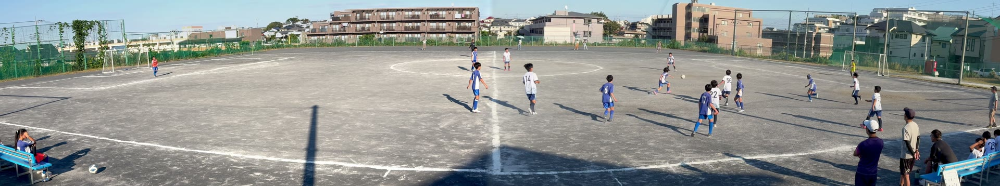
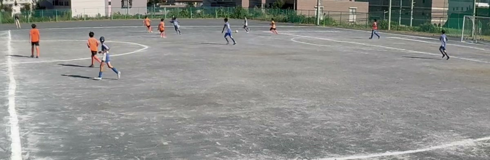

When we built panovi, the toughest situation we had in mind was a soccer match. It is outdoors, it is long, the players run all over, and there are no retakes. This post covers how to plan ahead so you can film a whole match from start to finish with the iPhones left on the tripod. The same goes for rugby and other field sports.

## Where to set up: in line with the halfway line, as high as you can

- Set the tripod up **in line with the halfway line** and both goals fit into the frame evenly
- Filming from **as high a spot as you can** means players in front overlap less with players behind them, so the whole flow of play is easier to follow. If there are stands or a bank, use them
- The seam sits in the middle of the frame, around the center circle. Pick a spot where people are unlikely to walk right in front of the camera, and the seam stays clean

Once set up, use **"Check the setup"** to check the overlap, and **"Preview 3 seconds of motion"** to make sure both goals are in frame. Get this done before kickoff.

## A third iPhone as a remote in your hand

If you have a third iPhone, it can be a remote in your hand. Just scan the first iPhone's QR code and choose **"Use as remote"**. You can also add one later with **"Add a remote"**.

From the remote, you can do the following without touching the cameras:

- Start and stop recording
- Check the seam
- Check each camera's battery and free space
- Pull over the videos you recorded

Since you don't need to go near the tripod, you can split the recording at halftime from the bench or the stands. You can film without a remote too.

## Battery and free space: the day before the match

There is no limit on recording length. What decides how long you can keep going is battery and free space.

- While recording, use **power save** to turn the screen off and save battery. The recording indicator and elapsed time stay large on screen
- For a long match, plugging a portable battery into each of the two iPhones gives you peace of mind
- Each side records in 4K, so even one match needs a good amount of free space. The day before, check your free space in **"Videos on This Device"** and clear out videos you don't need. If there isn't enough, the app tells you roughly how much you need

## Stitch the first and second halves together

After you stop recording, each recorded set appears in your library. With **"Stitch and save all"**, you can stitch them all in order in one go, however many there are, such as the first and second halves. Stitching takes time, so if you get it done in the car or on the train home, you can watch on the big screen as soon as you walk in.

## Pricing for long stitches

The only thing that can cost money is a **long stitch of 3 minutes or longer**. Recording, transfer and the setup check are free, for any length and any number.

- Stitches of 3 minutes or longer can be tried **3 times for free**
- After that, choose between an **event pass (24 hours)** and a **one-time unlock**
- An event pass gives you unlimited long stitches for 24 hours from the first stitch you use it on. The clock starts **when you first use it**, so buying it the night before costs you nothing. For a match day or a tournament day, one pass is all you need
- If you will keep filming every week, we recommend the one-time unlock: pay once, unlimited forever. It is not a subscription

## After the match

- **Zoom in within the app**: double-tap to zoom in, drag to pan left and right. Play away from the ball is all still there in the frame
- **Share with the team**: use "Export for YouTube" to make it 8K size, and it stays sharp even on a big screen. Set it to unlisted, and only people who have the URL can watch it

## Frequently asked questions

### Can I film a whole soccer match without a camera operator?

Yes. Set two iPhones side by side on a tripod, and you can film from kickoff to the final whistle in one video with both goals in frame. No one has to pan the camera, so whoever is filming can focus on watching and cheering too.

### How many iPhones do I need?

Two for filming. A third iPhone can be a remote in your hand, so you can start and stop recording or check the batteries without touching the cameras. You can film without a remote too.

### Does it cost anything to film a whole match?

Recording is free, for any length. Stitches of 3 minutes or longer can be tried 3 times for free, and after that it is an event pass (24 hours) or a one-time unlock. For a tournament or match day, one event pass lets you stitch as many videos as you like.

### Will the battery last until the end of the match?

It depends on the model, the temperature and the length of the match. While recording, turn the screen off with "power save", and plug a portable battery into each of the two iPhones for peace of mind.

## Read next

- [Getting started with panovi — shooting your first video](post:first-video)
- [Placing your iPhones for a clean stitch — the tripod and the shallow V](post:tripod-setup)
- [Pricing in detail](home:#price)

{{appstore}}
