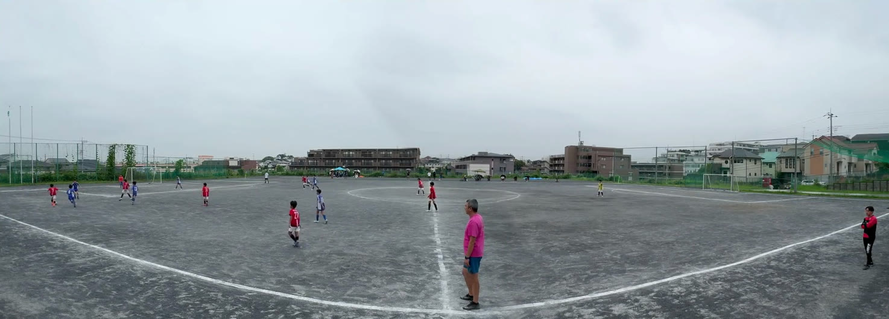
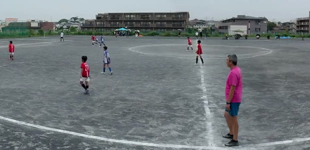

Cuando creamos panovi, el caso más exigente que teníamos en mente era un partido de fútbol. Es al aire libre, dura mucho, los jugadores se mueven por todos lados y no se puede repetir. En este artículo te contamos cómo prepararte para grabar un partido completo con el trípode fijo. Lo mismo sirve para el rugby y otros deportes de campo.

## Ubicación: en la prolongación de la línea de medio campo, lo más alto posible

- Si pones el trípode **en la prolongación de la línea de medio campo**, las dos porterías quedan dentro de forma equilibrada
- Si grabas **desde lo más alto posible**, los jugadores de adelante tapan menos a los de atrás y se ve mejor el movimiento de todo el equipo. Si hay gradas o un terraplén, aprovéchalos
- La unión queda en el centro de la imagen, cerca del círculo central. Elige un lugar donde sea difícil que alguien pase justo enfrente, y la unión se verá limpia

Cuando esté colocado, revisa la superposición con **“Verificar alineación”** y comprueba con **“Ver 3 segundos de movimiento”** que entren las dos porterías. Hazlo antes del saque inicial.

## Un tercer iPhone como control remoto en tu mano

Si tienes un tercer iPhone, puede ser tu control remoto. Solo escanea el código QR del primer iPhone y elige **“Usar como control remoto”**. También puedes sumarlo después con **“Agregar control remoto”**.

Desde el control remoto puedes hacer esto sin tocar las cámaras:

- Iniciar y detener la grabación
- Revisar la zona de unión
- Ver la batería y el espacio libre de cada cámara
- Traer los videos grabados

Como no tienes que acercarte al trípode, puedes cortar la grabación en el medio tiempo desde la banca o desde las gradas. El control remoto es opcional.

## Batería y espacio libre: el día antes del partido

No hay límite de duración. Lo que decide cuánto puedes grabar es la batería y el espacio libre.

- Mientras grabas, usa el **ahorro de energía** para apagar la pantalla y que la batería rinda más. El indicador de grabación y el tiempo transcurrido siguen viéndose en grande
- Para un partido largo, conviene tener los dos iPhone conectados a una batería externa
- Cada lado se graba en 4K, así que incluso un solo partido necesita bastante espacio libre. El día anterior, revisa el espacio en **“Videos en este iPhone”** y borra los videos que no necesites. Si no alcanza, la app te dice cuánto espacio hace falta más o menos

## Une el primer y el segundo tiempo de una vez

Cuando detienes la grabación, cada grabación aparece en la biblioteca. Con **“Unir y guardar todos”** se unen en orden, de una vez, todas las que haya, como el primer y el segundo tiempo. La unión toma tiempo, así que si la haces en el auto o en el tren de regreso, al llegar a casa ya puedes verlo en la pantalla grande.

## El precio de las uniones largas

Lo único que puede costar dinero son las **uniones largas, de 3 minutos o más**. Grabar, transferir y verificar la alineación es gratis, sin importar los minutos ni cuántas veces.

- Las uniones de 3 minutos o más las puedes probar **gratis 3 veces**
- Después, eliges entre el **pase de evento (24 horas)** y **Ilimitado (compra única)**
- Con el pase de evento, desde la primera unión en la que lo usas tienes 24 horas para hacer todas las uniones largas que quieras. El tiempo empieza a contar **cuando lo usas por primera vez**, así que comprarlo el día anterior no te hace perder nada. Para un día de partido o de torneo, un pase alcanza
- Si vas a seguir grabando cada semana, te recomendamos Ilimitado: pagas una vez y lo usas sin límite para siempre. No es una suscripción

## Después de grabar

- **Acércate en la app**: toca dos veces para acercarte y arrastra para moverte a los lados. Todo lo que pasa lejos del balón también queda en la imagen
- **Compártelo con el equipo**: con “Exportar para YouTube” en tamaño 8K, se ve el detalle incluso en una pantalla grande. Si lo publicas como no listado, solo lo ven quienes tienen la URL

## Preguntas frecuentes

### ¿Puedo grabar un partido de fútbol completo sin un camarógrafo?

Sí. Si pones dos iPhone uno al lado del otro en un trípode, grabas desde el saque inicial hasta el final del partido en un solo video con las dos porterías. Nadie tiene que mover la cámara, así que quien graba también puede concentrarse en ver el partido y alentar.

### ¿Cuántos iPhone necesito?

Dos para grabar. Si tienes un tercer iPhone, puede ser tu control remoto: inicias y detienes la grabación o revisas la batería sin tocar las cámaras. Sin control remoto también puedes grabar.

### ¿Cuesta dinero grabar un partido?

Grabar es gratis, sin importar los minutos. Las uniones de 3 minutos o más las puedes probar gratis 3 veces, y después eliges entre el pase de evento (24 horas) y la compra única. Para un día de partido o de torneo, con un solo pase de evento puedes unir todos los videos que quieras.

### ¿La batería dura hasta el final del partido?

Depende del modelo, la temperatura y la duración del partido. Mientras grabas, usa el “ahorro de energía” para apagar la pantalla, y conecta los dos iPhone a una batería externa para ir tranquilo.

## Sigue leyendo

- [Tu primer video con panovi — paso a paso](post:first-video)
- [Cómo colocarlos para una unión limpia — el trípode y la forma de V](post:tripod-setup)
- [Todos los detalles del precio](home:#price)

{{appstore}}
