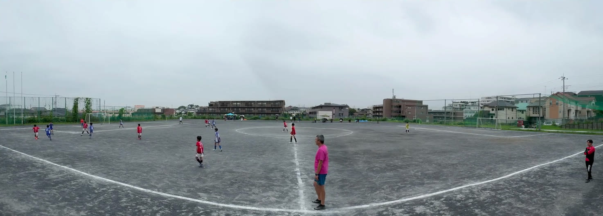

{{video:/img/hero-join-soccer.mp4|/img/hero-join-soccer-poster.jpg|Las imágenes de dos iPhone se convierten en un solo video ultrapanorámico (sin sonido)}}

{{appstore:top}}

Con panovi, grabas un partido de fútbol entero, con las dos porterías en la imagen, **solo poniendo dos iPhone uno al lado del otro en un trípode**. Nadie tiene que mover la cámara. Después, puedes **acercarte** a lo que quieras ver.

{{box:Qué necesitas}}
- Dos iPhone (uno puede ser prestado por alguien de la familia)
- Un trípode y un soporte para los dos iPhone ([cómo armarlo](post:tripod-setup))
- La app panovi (gratis, con compras dentro de la app) → [App Store](https://apps.apple.com/app/id6797261654)

Esta guía muestra cómo grabar un partido de principio a fin con el trípode fijo. Sirve también para rugby y otros deportes de campo.

## Ubicación: en la prolongación de la línea de medio campo, lo más alto posible

- Si pones el trípode **en la prolongación de la línea de medio campo**, las dos porterías quedan dentro de forma equilibrada
- Si grabas **desde lo más alto posible**, los jugadores de adelante tapan menos a los de atrás y se ve mejor el movimiento de todo el equipo. Si hay gradas o un terraplén, aprovéchalos
- La unión queda en el centro de la imagen, cerca del círculo central. Elige un lugar donde sea difícil que alguien pase justo enfrente, y la unión se verá limpia

Cuando esté colocado, revisa la superposición con **“Verificar alineación”** y comprueba con **“Ver 3 segundos de movimiento”** que entren las dos porterías. Hazlo antes del saque inicial.

## Un tercer iPhone como control remoto en tu mano

Si tienes un tercer iPhone, puede ser tu control remoto. Solo escanea el código QR del primer iPhone y elige **“Usar como control remoto”**. También puedes sumarlo después con **“Agregar control remoto”**.

Desde el control remoto puedes hacer esto sin tocar las cámaras:

- Iniciar y detener la grabación
- Revisar la zona de unión
- Ver la batería y el espacio libre de cada cámara
- Traer los videos grabados

Como no tienes que acercarte al trípode, puedes cortar la grabación en el medio tiempo desde la banca o desde las gradas. El control remoto es opcional.

## Batería y espacio libre: el día antes del partido

No hay límite de duración. Lo que decide cuánto puedes grabar es la batería y el espacio libre.

- Mientras grabas, usa el **ahorro de energía** para apagar la pantalla y que la batería rinda más. El indicador de grabación y el tiempo transcurrido siguen viéndose en grande
- Para un partido largo, conviene tener los dos iPhone conectados a una batería externa
- Cada lado se graba en 4K, así que incluso un solo partido necesita bastante espacio libre. El día anterior, revisa el espacio en **“Videos en este iPhone”** y borra los videos que no necesites. Si no alcanza, la app te dice cuánto espacio hace falta más o menos

## Une el primer y el segundo tiempo de una vez

Cuando detienes la grabación, cada grabación aparece en la biblioteca. Con **“Unir y guardar todos”** se unen en orden, de una vez, todas las que haya, como el primer y el segundo tiempo. La unión toma tiempo, así que si la haces en el auto o en el tren de regreso, al llegar a casa ya puedes verlo en la pantalla grande.

{{appstore:mid}}

## Después de grabar

- **Acércate en la app**: toca dos veces para acercarte y arrastra para moverte a los lados. Todo lo que pasa lejos del balón también queda en la imagen
- **Compártelo con el equipo**: con “Exportar para YouTube” en tamaño 8K, se ve el detalle incluso en una pantalla grande. Si lo publicas como no listado, solo lo ven quienes tienen la URL

## Preguntas frecuentes

### ¿Puedo grabar un partido de fútbol completo sin un camarógrafo?

Sí. Si pones dos iPhone uno al lado del otro en un trípode, grabas desde el saque inicial hasta el final del partido en un solo video con las dos porterías. Nadie tiene que mover la cámara, así que quien graba también puede concentrarse en ver el partido y alentar.

### ¿Cuántos iPhone necesito?

Dos para grabar. Si tienes un tercer iPhone, puede ser tu control remoto: inicias y detienes la grabación o revisas la batería sin tocar las cámaras. Sin control remoto también puedes grabar.

### ¿Cuesta dinero grabar un partido?

Grabar es gratis, sin importar los minutos. panovi es gratis, con compras dentro de la app. Mira los detalles en la [App Store](https://apps.apple.com/app/id6797261654).

### ¿La batería dura hasta el final del partido?

Depende del modelo, la temperatura y la duración del partido. Mientras grabas, usa el “ahorro de energía” para apagar la pantalla, y conecta los dos iPhone a una batería externa para ir tranquilo.

## Sigue leyendo

- [Tu primer video con panovi — paso a paso](post:first-video)
- [Cómo colocarlos para una unión limpia — el trípode y la forma de V](post:tripod-setup)

{{appstore}}
