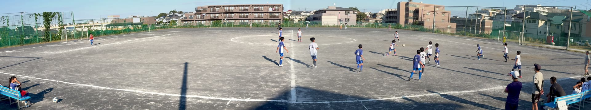
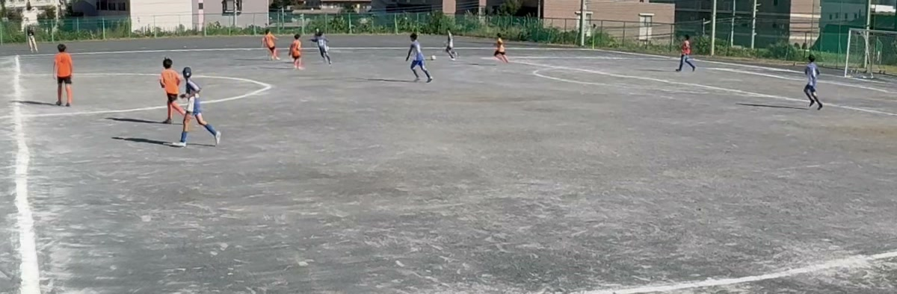

panovi を作るとき、いちばん厳しい場面として想定したのがサッカーの試合です。屋外で、長くて、選手は動き回り、撮り直しはできません。この記事では、三脚に置いたまま試合を最後まで撮るための段取りを紹介します。ラグビーなど、ほかのフィールドスポーツでも同じです。

## 置き場所：ハーフウェーラインの延長、なるべく高く

- **ハーフウェーラインの延長上**に三脚を立てると、左右のゴールまでがバランスよく入ります
- **なるべく高い場所**から撮ると、手前の選手と奥の選手の重なりが減り、全体の動きが見やすくなります。スタンドや土手があれば使いましょう
- つなぎ目は画面の真ん中、センターサークルのあたりにきます。目の前を人が横切りにくい場所を選ぶと、つなぎ目がきれいです

置いたら**「配置を確認」**で重なりを見て、**「3秒で動きを確認」**で両ゴールが入っているかを確かめます。キックオフの前に済ませておきましょう。

## 3台目のiPhoneを、手元のリモコンに

3台目のiPhoneがあれば、手元のリモコンになります。1台目のQRコードを読み取って**「リモコンにする」**を選ぶだけです。あとからでも**「リモコンを追加」**で加えられます。

リモコンからは、カメラに触れずに次のことができます。

- 録画の開始・停止
- つなぎ目の確認
- 各カメラの電池と空き容量の確認
- 撮った動画の取り寄せ

三脚に近づかずに済むので、ハーフタイムに録画を区切るのも、ベンチやスタンドからできます。リモコンはなくても撮れます。

## 電池と空き容量：試合の前日に

撮影の長さに制限はありません。続くかどうかを決めるのは、電池と空き容量です。

- 録画中は**省エネ**で画面を消しておくと、電池の減りを抑えられます。録画中の印と経過時間は大きく出たままです
- 長い試合なら、2台ともモバイルバッテリーをつないでおくと安心です
- 左右それぞれを4Kで記録するので、試合1本でもまとまった空き容量が要ります。前日に**「この端末の動画」**で空き容量を見て、いらない動画を片付けておきましょう。足りないときはアプリが必要な目安を教えてくれます

## 前半と後半をまとめてつなぐ

録画を止めたあと、撮った組はライブラリに並びます。**「すべて結合して保存」**を使えば、前半・後半など何本あっても順番にまとめてつなげます。結合は時間がかかるので、帰りの車や電車の中で済ませておくと、家に着いたらすぐ大画面で見られます。

## 長い結合の料金

お金がかかることがあるのは、**3分以上の長い結合**だけです。撮影・転送・配置の確認は、何分でも何本でも無料です。

- 3分以上の結合は、**無料で3回**まで試せます
- そのあとは **イベント券（24時間）** か **買い切り** から選べます
- イベント券は、最初に使った結合から24時間、長い結合が何本でも作れます。時間は**使い始めたとき**から数えるので、前日に買っておいても損しません。試合や大会の1日なら、これ1枚で足ります
- これからも毎週撮るなら、一度の支払いでずっと無制限の買い切りがおすすめです。月額ではありません

## 撮ったあとは

- **アプリで寄って見る**：ダブルタップで拡大、ドラッグで左右へ。ボールのない所の動きも、全部画面の中に残っています
- **チームで共有する**：「YouTube 用に書き出し」で8Kサイズにすれば、大画面でも細かさが残ります。限定公開にしておけば、URLを知っている人だけで見られます

## 次に読む

- [はじめての panovi — 最初の1本を撮るまで](post:first-video)
- [きれいにつながる置き方 — 三脚と「ハの字」のコツ](post:tripod-setup)
- [料金のくわしい説明](home:#price)

{{appstore}}
