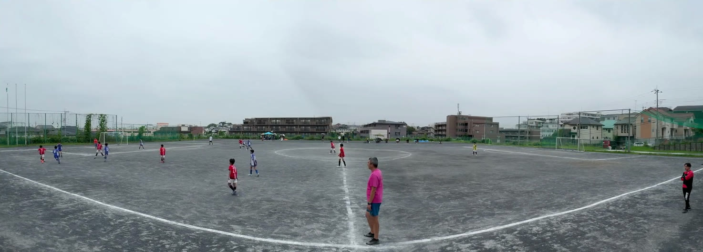

{{video:/img/hero-join-soccer.mp4|/img/hero-join-soccer-poster.jpg|As imagens de dois iPhones viram um só vídeo ultra-amplo (sem som)}}

{{appstore:top}}

Com o panovi, você filma um jogo de futebol inteiro, com as duas traves na imagem, **só colocando dois iPhones lado a lado em um tripé**. Ninguém precisa mover a câmera. Depois, você **dá zoom** onde quiser olhar.

{{box:O que você precisa}}
- Dois iPhones (um pode ser emprestado de alguém da família)
- Um tripé e um suporte para os dois iPhones ([como montar](post:tripod-setup))
- O app panovi (grátis para usar, com compras dentro do app) → [App Store](https://apps.apple.com/app/id6797261654)

Este guia mostra como filmar um jogo do começo ao fim com o tripé parado. Vale também para rúgbi e outros esportes de campo.

## Onde colocar: no prolongamento da linha do meio-campo, o mais alto possível

- Monte o tripé **no prolongamento da linha do meio-campo** para pegar as duas traves de forma equilibrada
- Filmar **do lugar mais alto possível** diminui a sobreposição entre os jogadores da frente e os do fundo, e fica mais fácil acompanhar o jogo todo. Se houver arquibancada ou um barranco, aproveite
- A emenda fica no meio da tela, perto do círculo central. Escolha um lugar onde ninguém fique passando bem na frente da câmera, e a emenda sai bonita

Depois de posicionar, use **“Verificar alinhamento”** para ver a sobreposição e **“Ver 3 segundos de movimento”** para conferir se as duas traves aparecem. Faça isso antes do pontapé inicial.

## Um terceiro iPhone como controle remoto na sua mão

Se você tiver um terceiro iPhone, ele vira um controle remoto na sua mão. Basta ler o código QR do primeiro iPhone e escolher **“Usar como controle”**. Também dá para incluir depois, em **“Adicionar controle”**.

Pelo controle, sem tocar nas câmeras, você pode:

- Iniciar e parar a gravação
- Conferir a emenda
- Ver a bateria e o espaço livre de cada câmera
- Trazer os vídeos gravados para ele

Como não precisa chegar perto do tripé, dá para dividir a gravação no intervalo direto do banco ou da arquibancada. Dá para filmar sem o controle também.

## Bateria e espaço livre: na véspera do jogo

Não há limite de duração. O que decide se a gravação vai até o fim é a bateria e o espaço livre.

- Durante a gravação, use a **economia de energia** para apagar a tela e a bateria render mais. O indicador de gravação e o tempo decorrido continuam grandes na tela
- Em jogos longos, é bom deixar uma bateria externa ligada em cada iPhone
- Cada lado grava em 4K, então até um jogo só ocupa bastante espaço. Na véspera, confira o espaço livre em **“Vídeos neste iPhone”** e apague os vídeos de que não precisa. Se faltar espaço, o app mostra quanto é preciso, mais ou menos

## Una o primeiro e o segundo tempo de uma vez

Quando você para a gravação, cada par de vídeos aparece na biblioteca. Com **“Unir e salvar todos”**, o app une em sequência quantos houver, como o primeiro e o segundo tempo. A união leva um tempo, então faça isso no carro ou no trem de volta. Ao chegar em casa, já dá para assistir na tela grande.

{{appstore:mid}}

## Depois de filmar

- **Dê zoom no app**: toque duas vezes para dar zoom e arraste para os lados. Tudo o que acontece longe da bola também fica guardado na imagem
- **Compartilhe com o time**: em “Exportar para uso no YouTube”, exporte em tamanho 8K para os detalhes continuarem nítidos até em uma tela grande. Se publicar como não listado, só quem tiver o link consegue assistir

## Perguntas frequentes

### Dá para filmar um jogo de futebol inteiro sem cinegrafista?

Dá. Coloque dois iPhones lado a lado em um tripé e você grava do pontapé inicial ao apito final em um só vídeo, com as duas traves na imagem. Ninguém precisa mover a câmera, então quem está gravando também pode assistir ao jogo e torcer.

### De quantos iPhones eu preciso?

Dois para filmar. Um terceiro vira um controle remoto na sua mão: sem tocar nas câmeras, você inicia e para a gravação ou confere a bateria. Dá para filmar sem o controle também.

### Filmar um jogo inteiro custa alguma coisa?

Gravar é grátis, com qualquer duração. O panovi é grátis para usar, com compras dentro do app. Veja os detalhes na [App Store](https://apps.apple.com/app/id6797261654).

### A bateria aguenta até o fim do jogo?

Depende do modelo, da temperatura e da duração do jogo. Durante a gravação, use a economia de energia para apagar a tela e deixe uma bateria externa ligada em cada iPhone para ficar tranquilo.

## Leia também

- [Primeiros passos com o panovi — até o seu primeiro vídeo](post:first-video)
- [Como posicionar para uma emenda perfeita — o tripé e o segredo do “V”](post:tripod-setup)

{{appstore}}
