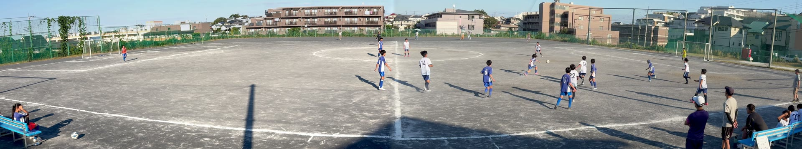
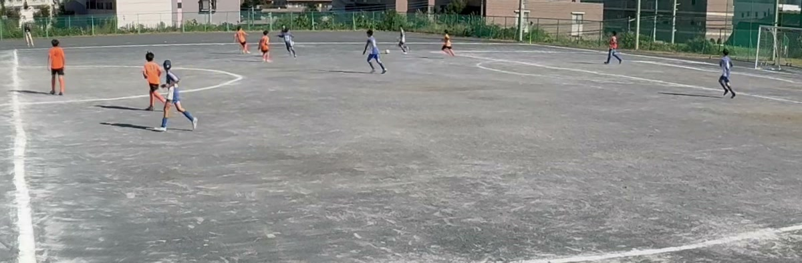

Quando criamos o panovi, o cenário mais difícil que imaginamos foi um jogo de futebol. É ao ar livre, é longo, os jogadores correm o tempo todo e não dá para repetir. Neste artigo, mostramos como se preparar para filmar o jogo inteiro sem tirar o tripé do lugar. Vale o mesmo para outros esportes de campo, como o rúgbi.

## Onde colocar: no prolongamento da linha do meio-campo, o mais alto possível

- Monte o tripé **no prolongamento da linha do meio-campo** para pegar as duas traves de forma equilibrada
- Filmar **do lugar mais alto possível** diminui a sobreposição entre os jogadores da frente e os do fundo, e fica mais fácil acompanhar o jogo todo. Se houver arquibancada ou um barranco, aproveite
- A emenda fica no meio da tela, perto do círculo central. Escolha um lugar onde ninguém fique passando bem na frente da câmera, e a emenda sai bonita

Depois de posicionar, use **“Verificar alinhamento”** para ver a sobreposição e **“Ver 3 segundos de movimento”** para conferir se as duas traves aparecem. Faça isso antes do pontapé inicial.

## Um terceiro iPhone como controle remoto na sua mão

Se você tiver um terceiro iPhone, ele vira um controle remoto na sua mão. Basta ler o código QR do primeiro iPhone e escolher **“Usar como controle”**. Também dá para incluir depois, em **“Adicionar controle”**.

Pelo controle, sem tocar nas câmeras, você pode:

- Iniciar e parar a gravação
- Conferir a emenda
- Ver a bateria e o espaço livre de cada câmera
- Trazer os vídeos gravados para ele

Como não precisa chegar perto do tripé, dá para dividir a gravação no intervalo direto do banco ou da arquibancada. Dá para filmar sem o controle também.

## Bateria e espaço livre: na véspera do jogo

Não há limite de duração. O que decide se a gravação vai até o fim é a bateria e o espaço livre.

- Durante a gravação, use a **economia de energia** para apagar a tela e a bateria render mais. O indicador de gravação e o tempo decorrido continuam grandes na tela
- Em jogos longos, é bom deixar uma bateria externa ligada em cada iPhone
- Cada lado grava em 4K, então até um jogo só ocupa bastante espaço. Na véspera, confira o espaço livre em **“Vídeos neste iPhone”** e apague os vídeos de que não precisa. Se faltar espaço, o app mostra quanto é preciso, mais ou menos

## Una o primeiro e o segundo tempo de uma vez

Quando você para a gravação, cada par de vídeos aparece na biblioteca. Com **“Unir e salvar todos”**, o app une em sequência quantos houver, como o primeiro e o segundo tempo. A união leva um tempo, então faça isso no carro ou no trem de volta. Ao chegar em casa, já dá para assistir na tela grande.

## O preço das uniões longas

A única coisa que pode custar dinheiro são as **uniões longas, de 3 minutos ou mais**. Gravar, transferir e verificar o alinhamento é grátis, com qualquer duração e quantas vezes quiser.

- Uniões de 3 minutos ou mais: você pode testar **3 vezes de graça**
- Depois, escolha entre o **passe de evento (24 horas)** e o **Ilimitado (compra única)**
- Com o passe de evento, você faz quantas uniões longas quiser durante 24 horas, a partir da primeira união em que usa o passe. O tempo começa a contar **quando você usa pela primeira vez**, então comprar na véspera não faz você perder nada. Para um dia de jogo ou de torneio, um passe basta
- Se você vai filmar toda semana, a melhor escolha é a compra única: paga uma vez e usa sem limite para sempre. Não é assinatura

## Depois de filmar

- **Dê zoom no app**: toque duas vezes para dar zoom e arraste para os lados. Tudo o que acontece longe da bola também fica guardado na imagem
- **Compartilhe com o time**: em “Exportar para uso no YouTube”, exporte em tamanho 8K para os detalhes continuarem nítidos até em uma tela grande. Se publicar como não listado, só quem tiver o link consegue assistir

## Leia também

- [Primeiros passos com o panovi — até o seu primeiro vídeo](post:first-video)
- [Como posicionar para uma emenda perfeita — o tripé e o segredo do “V”](post:tripod-setup)
- [Preços em detalhes](home:#price)

{{appstore}}
